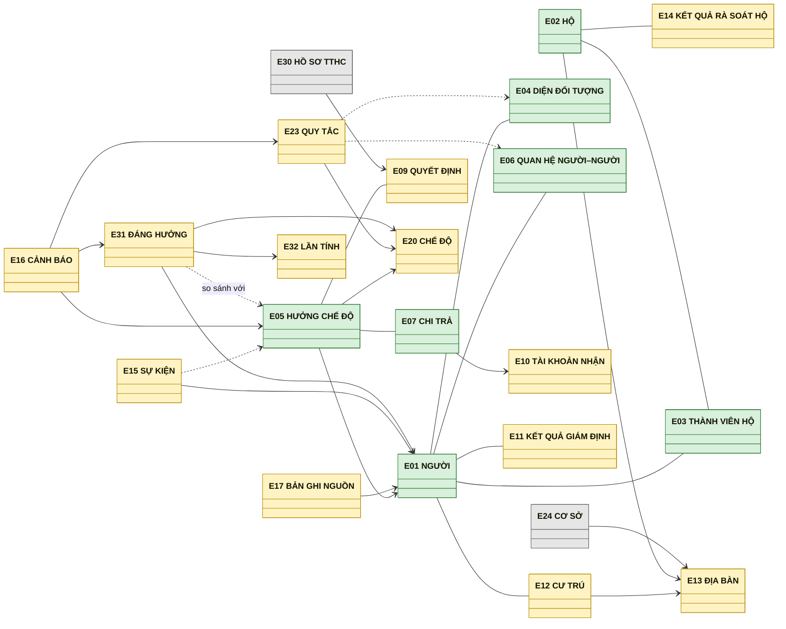
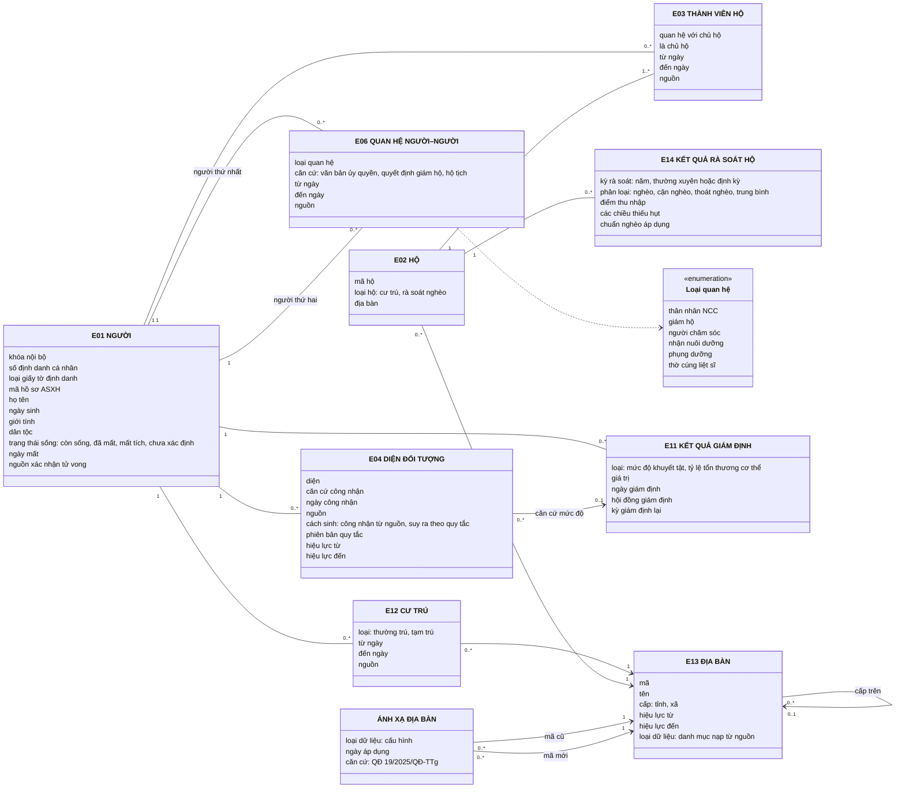
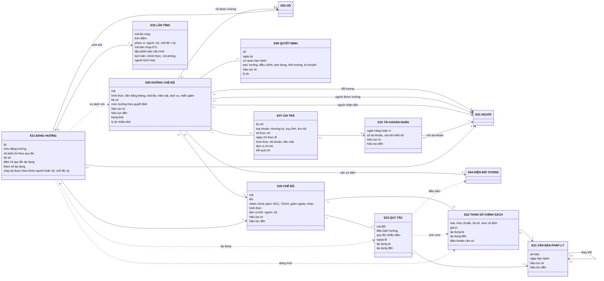
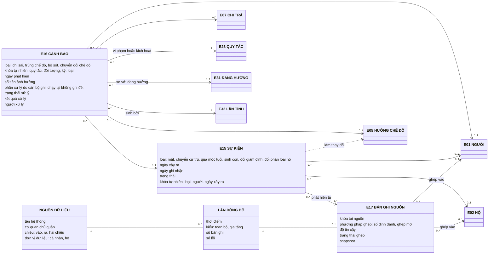
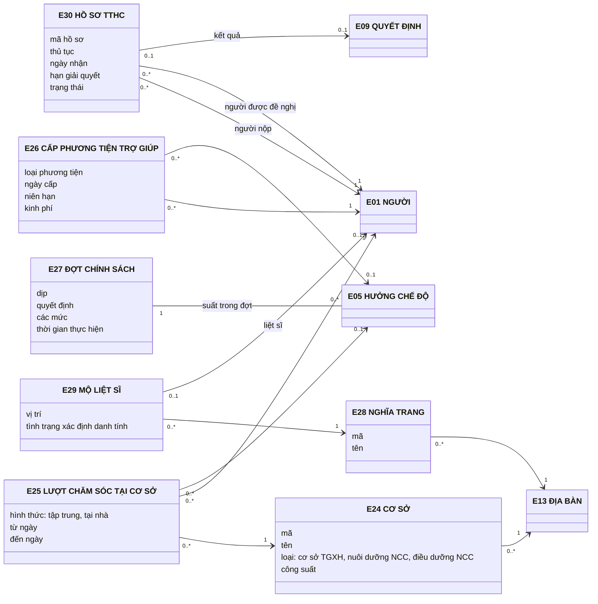
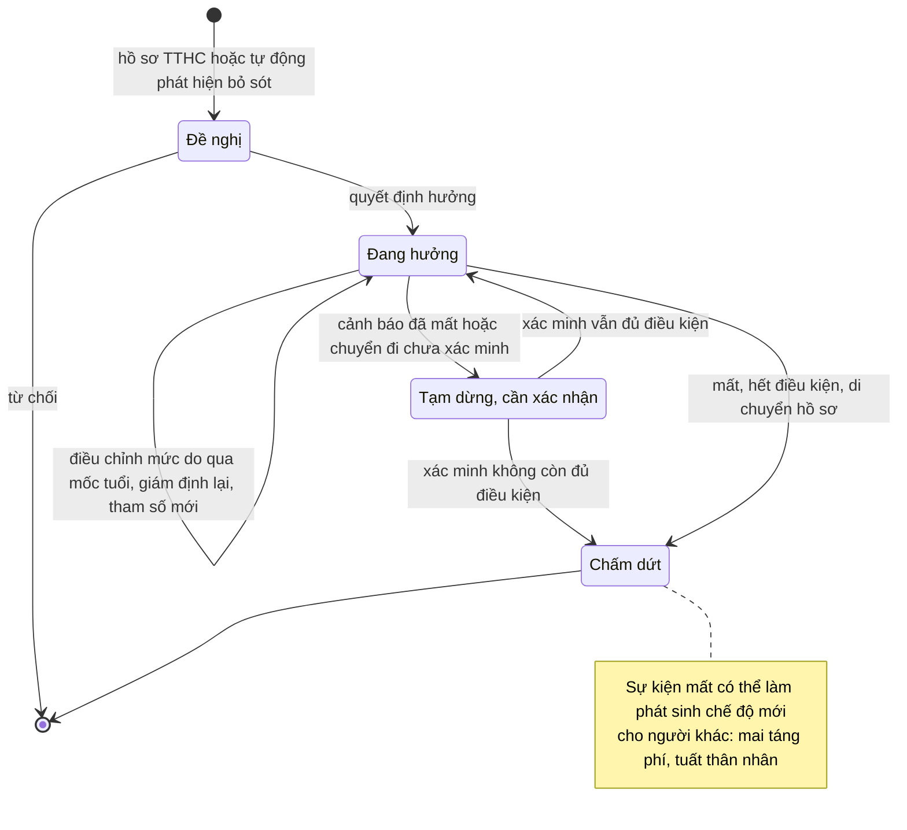
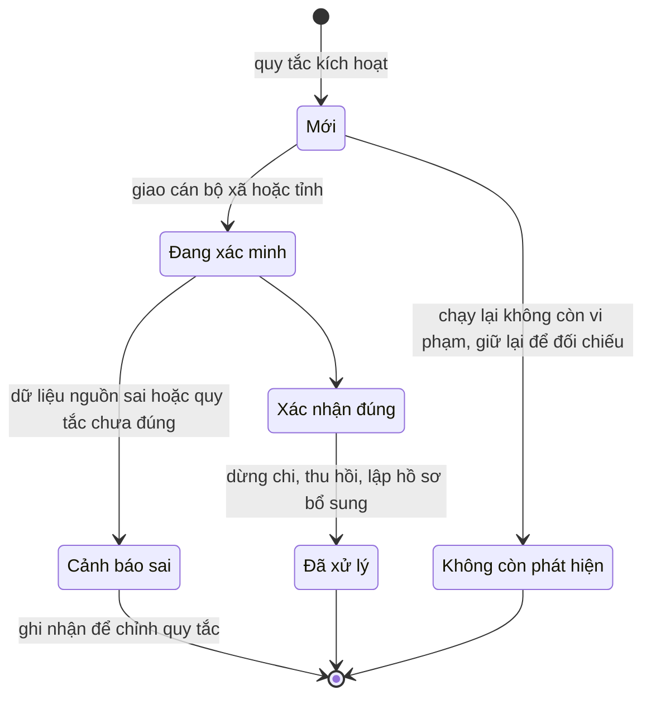
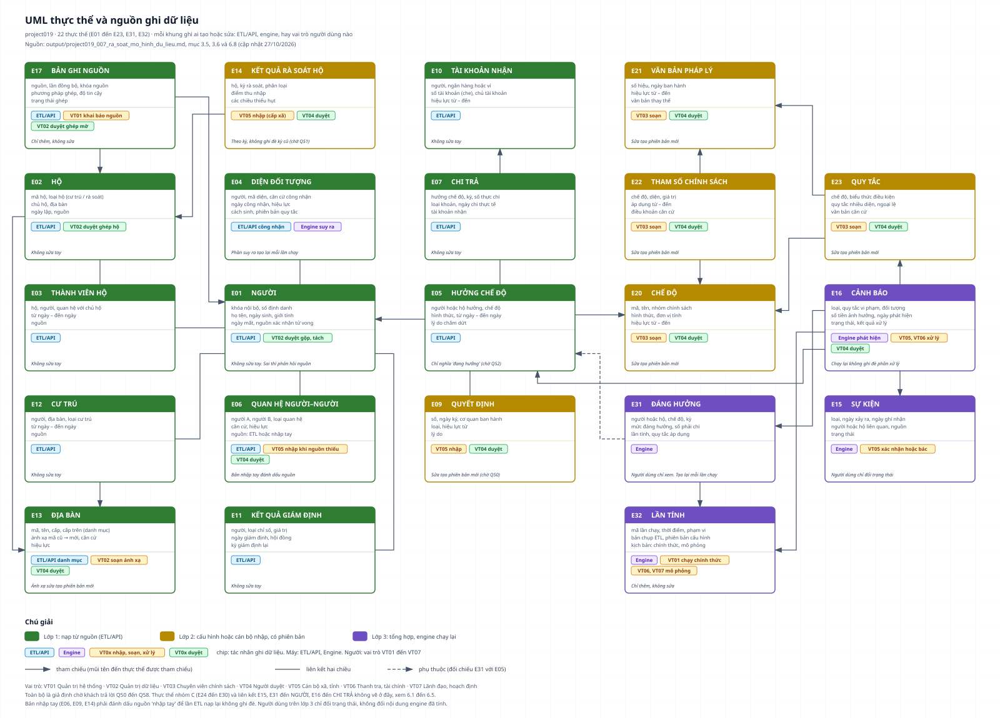
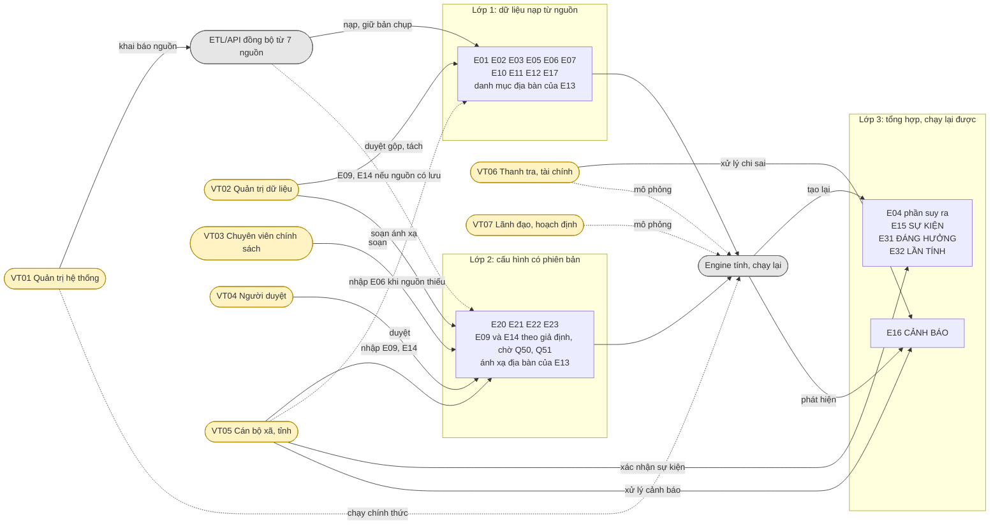

# Rà soát sheet "Mô hình dữ liệu", thực thể hoá theo use case và mô hình UML

Ngày lập: 26/10/2026. Người lập: BA project019. Cập nhật 27/10/2026: thêm E31 ĐÁNG HƯỞNG, E32 LẦN TÍNH và phân lớp dữ liệu (mục 3.5), vai trò thêm hoặc sửa dữ liệu (mục 3.6, sơ đồ 6.8).

Nguồn rà soát: sheet "Mô hình dữ liệu", "Task & Usecase", "Ứng dụng dữ liệu", "UC tham khảo PL III" của `work/project019_005_checklist_hop_dang_cap_nhat.xlsx`; báo cáo `output/project019_004_phan_tich_input.md` và `output/project019_006_ra_soat_can_cu_phap_ly.md`; tra cứu internet ngày 26/10/2026 (mục 8).

Trạng thái: mô hình trong tài liệu này ở mức khái niệm, trạng thái **Giả định**. Chưa có tài liệu API hay dữ liệu mẫu của nguồn nào, nên chưa kiểm chứng được thực thể nào có dữ liệu thật. Phạm vi người có công hay toàn bộ an sinh xã hội (câu Q27) quyết định nhóm C ở mục 3 có cần làm hay không.

Sơ đồ UML ở mục 6 viết bằng Mermaid. Bản SVG đã dựng sẵn nằm trong `output/project019_007_uml/`.

## 1. Kết quả tóm tắt

| Nội dung | Kết quả |
|---|---|
| Thực thể hiện có trong sheet | 8 |
| Thực thể hiện có cần sửa thuộc tính hoặc tách | 6 trên 8 (HỘ, DIỆN, HỒ SƠ HƯỞNG, QUAN HỆ, CHI TRẢ, QUY TẮC) |
| Thực thể đề xuất thêm, nhóm B (cần cho UC đã có trong Task & Usecase) | 10 |
| Thực thể đề xuất thêm, nhóm C (chỉ cần khi phạm vi gồm người có công đầy đủ theo PL III) | 7 |
| Thực thể hỗ trợ, ngoài mô hình nghiệp vụ (nhóm D) | 3 |
| Văn bản mới phát hiện chưa có trong báo cáo 006 | Pháp lệnh 05/2026/UBTVQH16, hiệu lực 01/01/2027 |
| Cập nhật 27/10/2026 (giả định, chờ Q50 đến Q55) | Thêm 2 thực thể nhóm B (E31, E32), sửa 6 thực thể (E04, E05, E07, E13, E16, E20), phân ba lớp dữ liệu (mục 3.5) |

Ba thiếu hụt ảnh hưởng nhiều nhất tới mốc T07 (15/11/2026):

1. Không có thực thể theo dõi nguồn gốc bản ghi. T06 ghép một người từ 7 nguồn nhưng mô hình không lưu bản ghi nào của nguồn nào đã ghép vào người đó. UC01 (chất lượng dữ liệu) và mọi cảnh báo chi sai cần biết dữ liệu đến từ đâu, cập nhật lúc nào.
2. Không có thực thể sự kiện và cảnh báo. UC11 dựa trên sự kiện vòng đời (mất, chuyển đi, qua mốc tuổi, thoát nghèo). UC06 đến UC10 tạo ra danh sách sai sót, bỏ sót cần theo dõi đến khi xử lý xong. Cả hai hiện chỉ là thuộc tính hoặc kết quả truy vấn, không có chỗ lưu.
3. HỒ SƠ HƯỞNG gộp ba thứ khác nhau: hồ sơ thủ tục hành chính, quyết định hưởng và chế độ đang hưởng. Dự thảo NĐ CSDL ASXH tách "quyết định hưởng, chế độ hưởng, thời gian hưởng" trong nhóm thông tin hưởng chính sách. Tên gọi cũng trùng với "hồ sơ an sinh xã hội" của dự thảo, vốn là hồ sơ theo từng người.

## 2. Đối chiếu với dự thảo NĐ CSDL quốc gia về ASXH

Sheet ghi "bám 5 nhóm thông tin dự thảo NĐ". Hai nguồn báo chí mô tả dự thảo khác nhau: VietnamPlus nêu 5 nhóm, Đại biểu Nhân dân nêu 6 nhóm (thêm nhóm hộ gia đình). Cả hai đều là tường thuật, chưa phải toàn văn dự thảo.

| Nhóm thông tin theo dự thảo | Chi tiết theo nguồn | Thực thể hiện có | Khoảng trống |
|---|---|---|---|
| Thông tin cơ bản / dùng chung | Định danh cá nhân, trạng thái hồ sơ, thông tin tử vong | NGƯỜI | Thiếu mã hồ sơ ASXH, ngày mất, nguồn xác nhận tử vong |
| Thân nhân | Không nêu chi tiết | QUAN HỆ NGƯỜI–NGƯỜI | Thiếu căn cứ quan hệ (văn bản ủy quyền thờ cúng, quyết định giám hộ) |
| Hộ gia đình (chỉ có ở nguồn Đại biểu Nhân dân) | Không nêu chi tiết | HỘ, THÀNH VIÊN HỘ | Thiếu kết quả rà soát hộ theo kỳ |
| Hưởng chính sách | Nhóm đối tượng, quyết định hưởng, chế độ hưởng, thời gian hưởng | DIỆN, HỒ SƠ HƯỞNG | Thiếu QUYẾT ĐỊNH, danh mục CHẾ ĐỘ |
| Chi trả | Không nêu chi tiết | CHI TRẢ | Thiếu TÀI KHOẢN NHẬN, phân biệt số phải chi và số thực chi |
| Chính sách / trợ cấp khác | BHYT, hỗ trợ việc làm, nhà ở, vay vốn ưu đãi, miễn giảm thuế | Không có | Chưa có cách ghi ưu đãi không phải tiền |

Dự thảo còn nêu hai điểm liên quan trực tiếp tới mô hình:

1. Số định danh cá nhân là khóa thống nhất cho công dân. Người nước ngoài, hộ gia đình và đối tượng không phải cá nhân dùng mã định danh tương ứng. Mô hình cần khóa nội bộ riêng cho người không có số định danh: liệt sĩ, người có công đã mất trước khi cấp định danh, trẻ chưa đăng ký.
2. Mỗi đối tượng có một mã hồ sơ ASXH duy nhất sau đối soát. Mã này là thuộc tính của NGƯỜI, không phải của từng chế độ.

CSDL quốc gia ASXH dự kiến có 7 CSDL thành phần: người có công, đối tượng trợ giúp xã hội, trẻ em, hộ nghèo và cận nghèo, bảo hiểm thất nghiệp, người cai nghiện và sau cai nghiện, cơ sở trợ giúp xã hội. Mô hình hiện tại không có thực thể cho CSDL thành phần cuối cùng (cơ sở trợ giúp xã hội). Hai nhóm bảo hiểm thất nghiệp và cai nghiện không có UC nào trong Task & Usecase. Cần hỏi 7 nguồn API của dự án có trùng 7 CSDL thành phần này không (bổ sung cho câu hỏi ở mục 4.2 báo cáo 004).

## 3. Danh sách thực thể đề xuất

Mã E01 đến E32 dùng nội bộ để truy vết, chưa đưa vào checklist.

### 3.1. Nhóm A: thực thể hiện có, cần sửa

| Mã | Thực thể | Vấn đề | Đề xuất | UC bị ảnh hưởng |
|---|---|---|---|---|
| E01 | NGƯỜI | "Trạng thái sống/mất" thiếu ngày mất và nguồn xác nhận. "Cư trú" là một thuộc tính nên mất lịch sử di chuyển | Thêm: khóa nội bộ, loại giấy tờ định danh, mã hồ sơ ASXH, ngày mất, nguồn xác nhận tử vong, ngày ghi nhận, dân tộc. Tách cư trú sang E12 | UC07, UC11, UC14, UC16; PL III 102, 106, 191 |
| E02 | HỘ | "Phân loại" và "kỳ rà soát" là thuộc tính một giá trị, nên không theo dõi được hộ qua nhiều kỳ. Chưa phân biệt hộ rà soát nghèo và hộ cư trú (đã ghi ở T08) | Thêm "loại hộ" (hộ cư trú / hộ rà soát). Chuyển phân loại sang E14 | UC15, UC17, T08 |
| E03 | THÀNH VIÊN HỘ | Đủ cho nhu cầu hiện tại | Thêm nguồn dữ liệu | UC05 |
| E04 | DIỆN ĐỐI TƯỢNG | "Mức độ" gộp mức độ khuyết tật và tỷ lệ tổn thương cơ thể. Hai chỉ số này có ngày giám định và có thể giám định lại | Tách "mức độ" sang E11. Thêm căn cứ công nhận (quyết định, giấy xác nhận) và ngày công nhận. Cập nhật 27/10: thêm cách sinh (công nhận từ nguồn hay suy ra theo quy tắc) và phiên bản quy tắc | UC06, UC09; PL III 151, 166, 167 |
| E05 | HỒ SƠ HƯỞNG → đổi tên HƯỞNG CHẾ ĐỘ | Gộp hồ sơ TTHC, quyết định và chế độ đang hưởng. Tên trùng "hồ sơ ASXH" của dự thảo. "Người được hưởng" trong ví dụ là hộ B, tức có thể là hộ chứ không chỉ người | Đổi tên. Tách quyết định sang E09, chế độ sang E20. Người được hưởng tham chiếu NGƯỜI hoặc HỘ. Thêm hình thức (tiền hằng tháng, một lần, hiện vật, dịch vụ, miễn giảm) và lý do chấm dứt (PL III 28). Cập nhật 27/10: chỉ giữ nghĩa "đang hưởng", kết quả tính nằm ở E31 | UC04, UC06, UC07, UC12 |
| E06 | QUAN HỆ NGƯỜI–NGƯỜI | Danh sách loại quan hệ thiếu "người phụng dưỡng" và "người thờ cúng". Với người cao tuổi theo NĐ 335/2026, việc không có người phụng dưỡng là điều kiện hưởng, nên quan hệ này phải có trong mô hình. Thiếu căn cứ quan hệ | Bổ sung loại: phụng dưỡng, thờ cúng liệt sĩ (Điều 28 khoản 6 NĐ 131/2021 yêu cầu văn bản ủy quyền). Thêm thuộc tính căn cứ, nguồn | UC09, UC10, UC13; PL III 80, 124 |
| E07 | CHI TRẢ | Chỉ có số tiền thực chi. Không so được với số phải chi. Không có tài khoản nhận nên không làm được dấu hiệu "một tài khoản nhận cho nhiều người" (nhóm N2) | Thêm: loại khoản (thường kỳ, truy lĩnh, thu hồi), ngày chi thực tế, đơn vị chi trả, tham chiếu E10. Số phải chi theo quy tắc nằm ở E31 (cập nhật 27/10) | UC07, UC08, UC12; PL III 64, 129, 135 |
| E08 | QUY TẮC CHÍNH SÁCH | Gộp danh mục chế độ, văn bản, tham số và điều kiện. Báo cáo 006 đã chỉ ra một văn bản có thể có hai mốc áp dụng (NĐ 335/2026, NĐ 321/2026) | Tách thành 4 thực thể E20 đến E23 (nhóm B) | T09, UC06, UC09, UC12 |

### 3.2. Nhóm B: thực thể cần thêm cho UC đã có

| Mã | Thực thể | Ý nghĩa | Thuộc tính chính | UC, task, mục PL III cần |
|---|---|---|---|---|
| E09 | QUYẾT ĐỊNH | Văn bản hành chính làm phát sinh, thay đổi hoặc chấm dứt một chế độ | Số, ngày ký, cơ quan ban hành, loại (hưởng, điều chỉnh, tạm dừng, thôi hưởng, di chuyển), hiệu lực từ, lý do | UC07, UC11; PL III 79, 103 |
| E10 | TÀI KHOẢN NHẬN | Tài khoản hoặc hình thức nhận tiền của một người | Ngân hàng hoặc ví, số tài khoản (che khi hiển thị), chủ tài khoản, hiệu lực từ – đến | N2; PL III 64, 65 |
| E11 | KẾT QUẢ GIÁM ĐỊNH | Mức độ khuyết tật hoặc tỷ lệ tổn thương cơ thể tại một thời điểm | Người, loại chỉ số, giá trị, ngày giám định, hội đồng, kỳ giám định lại | UC06, UC09; PL III 151, 166, 167 |
| E12 | CƯ TRÚ | Lịch sử nơi thường trú, tạm trú | Người, địa bàn, loại cư trú, từ ngày – đến ngày, nguồn | UC11, UC14; PL III 102, 105, 106, 191 |
| E13 | ĐỊA BÀN và ÁNH XẠ ĐỊA BÀN | Đơn vị hành chính tỉnh, xã và bảng chuyển mã cũ → mới | Mã, tên, cấp, cấp trên, hiệu lực; bảng ánh xạ: mã cũ, mã mới, ngày áp dụng, căn cứ. Cập nhật 27/10: tách danh mục (nạp từ nguồn) và ánh xạ (cấu hình) | T05, UC02, UC14; PL III 29 |
| E14 | KẾT QUẢ RÀ SOÁT HỘ | Phân loại hộ trong một kỳ rà soát | Hộ, kỳ (thường xuyên, định kỳ theo TT 25/2026/TT-BNNMT), phân loại, điểm thu nhập, các chiều thiếu hụt | UC11 (hộ thoát nghèo), UC15, UC17 |
| E15 | SỰ KIỆN | Thay đổi thực tế làm thay đổi quyền hưởng | Loại (mất, chuyển cư trú, qua mốc tuổi, sinh con, thay đổi giám định, đổi phân loại hộ), ngày xảy ra, ngày ghi nhận, nguồn, người hoặc hộ liên quan | UC11, N5; PL III 102 đến 106, 142, 190 |
| E16 | CẢNH BÁO | Kết quả kiểm tra một quy tắc, cần xác minh và xử lý | Loại (chi sai, trùng chế độ, bỏ sót, chuyển đổi chế độ), quy tắc vi phạm, đối tượng liên quan, số tiền ảnh hưởng, trạng thái xử lý, người xử lý. Cập nhật 27/10: tách phần phát hiện (engine, khóa quy tắc + đối tượng + kỳ + loại) và phần xử lý (cán bộ ghi, chạy lại không ghi đè) | UC06 đến UC11, UC19; PL III 52 đến 55, 62 đến 67, 72 đến 74, 129 đến 134 |
| E17 | NGUỒN, LẦN ĐỒNG BỘ, BẢN GHI NGUỒN | Nguồn gốc của mọi dữ liệu đã ghép | Nguồn: cơ quan, chiều dữ liệu. Lần đồng bộ: thời điểm, số bản ghi, lỗi. Bản ghi nguồn: khóa nguồn, người hoặc hộ đã ghép, phương pháp ghép, độ tin cậy | T02, T03, T06, UC01; PL III 38 đến 61, 148, 149 |
| E20 | CHẾ ĐỘ | Danh mục chế độ, trợ cấp, ưu đãi | Mã, tên, nhóm chính sách, hình thức, đơn vị tính (người, hộ), hiệu lực từ – đến (cập nhật 27/10) | T04, T09 |
| E21 | VĂN BẢN PHÁP LÝ | Văn bản căn cứ, kể cả văn bản đã hết hiệu lực | Số hiệu, ngày ban hành, hiệu lực từ – đến, văn bản thay thế | T09; sheet Căn cứ pháp lý |
| E22 | THAM SỐ CHÍNH SÁCH | Mức chuẩn, hệ số theo thời kỳ | Chế độ, diện, giá trị, áp dụng từ – đến (tách khỏi hiệu lực văn bản), điều khoản căn cứ | T09, UC07, UC12 |
| E23 | QUY TẮC | Điều kiện hưởng và quy tắc kết hợp | Chế độ, biểu thức điều kiện, quy tắc nhiều diện, ngoại lệ, văn bản căn cứ | T09, UC06, UC09, UC10 |
| E31 | ĐÁNG HƯỞNG | Kết quả hệ thống tính: người hoặc hộ đáng được hưởng chế độ nào, mức nào, kỳ nào (thêm 27/10, giả định) | Người hoặc hộ, chế độ, kỳ, mức đáng hưởng, số phải chi theo quy tắc, hệ số, diện và quy tắc áp dụng, tham số áp dụng, lần tính | UC06 đến UC12, UC19 |
| E32 | LẦN TÍNH | Một lần chạy engine, để giải thích và đối soát kết quả (thêm 27/10, giả định) | Mã lần chạy, thời điểm, phạm vi (người, hộ, chế độ × kỳ), mã bản chụp ETL, tập phiên bản cấu hình, kịch bản (chính thức, mô phỏng), người kích hoạt | T03, T09, UC06 đến UC12 |

Mã E18 và E19 để trống, dành cho thực thể phát sinh khi có tài liệu API. E24 đến E30 thuộc nhóm C (mục 3.3), nên E31 và E32 đánh số tiếp.

Ưu đãi không phải tiền (BHYT, học phí, nhà ở, vay vốn, miễn giảm thuế, giao đất) không cần thực thể riêng. Ghi chúng là HƯỞNG CHẾ ĐỘ với hình thức "dịch vụ", "hiện vật" hoặc "miễn giảm" và không có kỳ CHI TRẢ. Cách này phủ nhóm "chính sách khác" của dự thảo và PL III 114 đến 123, 153, 154, 168 đến 171 (UC16).

### 3.3. Nhóm C: thực thể theo phạm vi người có công (phụ thuộc Q27)

| Mã | Thực thể | Ý nghĩa | Thuộc tính chính | Mục PL III |
|---|---|---|---|---|
| E24 | CƠ SỞ | Cơ sở trợ giúp xã hội, cơ sở nuôi dưỡng, điều dưỡng người có công | Mã, tên, loại, địa bàn, công suất | 35, 157, 175 |
| E25 | LƯỢT CHĂM SÓC TẠI CƠ SỞ | Một lần nuôi dưỡng hoặc điều dưỡng | Người, cơ sở, hình thức (tập trung, tại nhà), từ ngày – đến ngày | 108, 115, 158, 159, 176 |
| E26 | CẤP PHƯƠNG TIỆN TRỢ GIÚP | Phương tiện trợ giúp, dụng cụ chỉnh hình đã cấp | Người, loại, ngày cấp, niên hạn, kinh phí | 116, 160, 177 đến 179 |
| E27 | ĐỢT CHÍNH SÁCH | Chính sách ban hành theo đợt: quà Chủ tịch nước, hỗ trợ nhà ở theo giai đoạn | Dịp, quyết định, mức, thời gian. Mỗi suất là một HƯỞNG CHẾ ĐỘ thuộc đợt | 119, 161, 162, 180 đến 182 |
| E28 | NGHĨA TRANG | Nghĩa trang liệt sĩ | Mã, tên, địa bàn | 33, 58, 59 |
| E29 | MỘ LIỆT SĨ | Mộ, gắn với liệt sĩ nếu đã xác định danh tính | Nghĩa trang, vị trí, tình trạng xác định danh tính, liệt sĩ | 60, 61 |
| E30 | HỒ SƠ TTHC | Một yêu cầu giải quyết thủ tục, theo dõi tiến độ | Mã hồ sơ, thủ tục (QĐ 320/QĐ-BNV), người nộp, người được đề nghị, ngày nhận, hạn, trạng thái, quyết định kết quả | 38 đến 45, 145, 186 |

Nếu phạm vi chỉ là trợ giúp xã hội và giảm nghèo, vẫn cần E24 và E25 vì NĐ 335/2026 quy định chăm sóc, nuôi dưỡng tại cơ sở trợ giúp xã hội và dự thảo có CSDL thành phần riêng về cơ sở trợ giúp xã hội. UC18 (nhu cầu cơ sở bảo trợ) cũng dùng E24.

### 3.4. Nhóm D: thực thể hỗ trợ, không vẽ trong mô hình nghiệp vụ

1. DANH MỤC DÙNG CHUNG và BẢNG CHUYỂN MÃ theo từng nguồn (T04; PL III 25 đến 28, 30, 32).
2. NGƯỜI DÙNG, VAI TRÒ, NHẬT KÝ TRA CỨU (T10; Luật BVDLCN 91/2025 và NĐ 356/2025 yêu cầu ghi vết truy cập dữ liệu nhạy cảm).
3. TỪ ĐIỂN DỮ LIỆU và ĐỊNH NGHĨA CHỈ SỐ (N8; PL III 193 đến 197; TT 13/2025/TT-BNV).

### 3.5. Lớp dữ liệu và chạy lại (cập nhật 27/10/2026)

Nguồn: nhận định của bên giao việc về nguồn ghi dữ liệu, đối chiếu với từng thực thể. Ai thêm hoặc sửa từng thực thể xem mục 3.6. Chi tiết 22 thực thể, 12 chuỗi ảnh hưởng, 10 quy tắc chạy lại và 8 điều chỉnh nằm ở sheet "Nguồn thực thể" của `work/project019_005_checklist_hop_dang_cap_nhat.xlsx`. Toàn bộ là giả định chờ khách trả lời Q50 đến Q55.

Dữ liệu chia ba lớp theo ai sinh ra nó. Có phiên bản theo thời gian chưa đủ để xếp vào lớp cấu hình: E03 và E12 cũng có hiệu lực từ – đến nhưng do nguồn cấp.

| Lớp | Thực thể | Tác nhân ghi | Chạy lại |
|---|---|---|---|
| 1. Dữ liệu ETL/API | E01, E02, E03, E06, E07, E10, E11, E12, E17; danh mục địa bàn của E13; E05 theo nghĩa "đang hưởng" | ETL/API từ nguồn | Không. Nạp tăng dần, giữ bản chụp |
| 2. Cấu hình có phiên bản | E20, E21, E22, E23; ánh xạ địa bàn của E13; E09 QUYẾT ĐỊNH và E14 KẾT QUẢ RÀ SOÁT HỘ (giả định theo nhận định, chờ Q50, Q51) | Cán bộ cấu hình và cán bộ nhập (E09, E14) | Không, là đầu vào. Sửa tạo phiên bản mới |
| 3. Tổng hợp | E15, E16 (phần phát hiện), E31, E32; phần suy ra của E04 | Engine từ lớp 1 và lớp 2 | Có, chạy lại liên tục |

Thay đổi so với mô hình trước, đã áp vào sheet "Mô hình dữ liệu" ngày 27/10/2026 dưới dạng giả định:

1. Thêm E31 ĐÁNG HƯỞNG: kết quả engine tính theo người hoặc hộ × chế độ × kỳ. E05 chỉ còn nghĩa "đang hưởng" do nguồn cấp. Cảnh báo (E16) sinh từ việc so E31 với E05 và E07. Mô hình cũ chỉ so ngầm trong truy vấn nên không có chỗ lưu "đáng hưởng". Nhận định ban đầu xếp E05 vào lớp tổng hợp, nên đây là điểm cần chốt: câu hỏi Q52.
2. Thêm E32 LẦN TÍNH: mã lần chạy, phạm vi, mã bản chụp ETL, tập phiên bản cấu hình, kịch bản chính thức hoặc mô phỏng. Mục đích là giải thích được vì sao có một cảnh báo và chạy lại không đổi kết quả.
3. E07 chỉ giữ số thực chi từ nguồn. "Số phải chi theo quy tắc" chuyển sang E31.
4. E04 thêm "cách sinh" (công nhận từ nguồn hay suy ra theo quy tắc) và phiên bản quy tắc, để chạy lại chỉ tạo lại phần suy ra.
5. E16 tách phần phát hiện (engine ghi theo khóa quy tắc, đối tượng, kỳ, loại) khỏi phần xử lý (cán bộ ghi). Chạy lại không được ghi đè phần xử lý. Trạng thái "không còn phát hiện" được thêm vào sơ đồ 6.7.
6. E20 thêm hiệu lực từ – đến. E13 tách danh mục (nạp) và ánh xạ (cấu hình).

Mã E31 và E32 đánh số tiếp sau nhóm C (E24 đến E30).

Mức ảnh hưởng: thay đổi từ ETL tác động theo một người hoặc một hộ nên tính lại tăng dần được. Thay đổi cấu hình (ví dụ mức chuẩn 540.000) tác động theo chế độ × khoảng hiệu lực, có thể là toàn bộ đối tượng của chế độ, nên chạy nền và so trước sau. Thao tác gộp hoặc tách người ở bước ghép định danh (E17) kéo theo mọi thực thể gắn với người đó.

### 3.6. Ai thêm hoặc sửa dữ liệu của từng thực thể (cập nhật 27/10/2026)

Sơ đồ UML ở mục 6.1 đến 6.7 vẽ liên kết giữa các thực thể. Mục này trả lời câu khác: dữ liệu của mỗi thực thể do tác nhân nào ghi vào hệ thống, là ETL/API đồng bộ hay người dùng, và nếu là người dùng thì vai trò nào. Sơ đồ 6.8 vẽ cùng nội dung. Toàn bộ là giả định chờ Q50 đến Q58; danh sách vai trò người dùng là đề xuất của BA dựa trên cột "Người dùng" ở sheet Task & Usecase và 009 mục 3.2, chưa có tài liệu phân quyền của nguồn.

Kết quả chính: 10 trên 22 thực thể người dùng không sửa tay (E01, E02, E03, E04, E05, E07, E10, E11, E12, E31); E01 và E02 chỉ có thao tác duyệt gộp, tách của VT02. Người dùng ghi dữ liệu ở bốn chỗ: cấu hình chính sách (E20 đến E23, ánh xạ E13), dữ liệu cán bộ nhập (E09, E14, và E06 khi nguồn thiếu), xử lý kết quả do engine sinh (E15, E16), khai báo và duyệt kỹ thuật (nguồn và ghép mờ ở E17, lần tính E32). E09 và E14 đã chốt giả định ở lớp 2 theo nhận định của bên giao việc (cán bộ nhập, có phiên bản, VT04 duyệt); chuyển sang lớp 1 nếu Q50, Q51 cho biết nguồn đã lưu.

| Mã | Thực thể | Lớp | Ai tạo và nạp lại (máy) | Vai trò người dùng thêm hoặc sửa | Duyệt | Cách sửa | Câu hỏi |
|---|---|---|---|---|---|---|---|
| E01 | NGƯỜI | 1. ETL/API | ETL/API. Khóa nội bộ do bước ghép định danh (T06) cấp | Không sửa tay. VT02 Quản trị dữ liệu chỉ duyệt gộp hoặc tách người qua E17 | VT02 Quản trị dữ liệu | Nạp lại ghi bản chụp. Nguồn sai thì phản hồi về nguồn | Q55 |
| E02 | HỘ | 1. ETL/API | ETL/API. Ghép hộ (T08) do hệ thống đề xuất | Không sửa tay. VT02 Quản trị dữ liệu duyệt ghép hộ | VT02 Quản trị dữ liệu | Như E01 | Q55 |
| E03 | THÀNH VIÊN HỘ | 1. ETL/API | ETL/API | Không | — | Không sửa tay | — |
| E04 | DIỆN ĐỐI TƯỢNG | 3. Tổng hợp (một phần lớp 1) | ETL/API (phần công nhận từ nguồn) và Engine tính (phần suy ra theo quy tắc) | Không | — | Phần suy ra tạo lại mỗi lần chạy. Phần công nhận do nguồn nạp | Q31, Q33 |
| E05 | HƯỞNG CHẾ ĐỘ | 1. ETL/API (giả định D1) | ETL/API | Không | — | Không sửa tay | Q52 |
| E06 | QUAN HỆ NGƯỜI–NGƯỜI | 1. ETL/API | ETL/API | Ngoại lệ khi nguồn thiếu (ủy quyền thờ cúng, người chăm sóc): VT05 Cán bộ xã, tỉnh nhập | VT04 Người duyệt | Bản nhập tay đánh dấu nguồn 'nhập tay', giữ nguyên khi ETL nạp lại | Q45, Q46, Q57 |
| E07 | CHI TRẢ | 1. ETL/API | ETL/API | Không | — | Không sửa tay | Q32 |
| E09 | QUYẾT ĐỊNH | 2. Cấu hình (giả định D8, chờ Q50) | Người dùng nhập. ETL/API chỉ khi nguồn có lưu (ngoại lệ, chờ Q31, Q50) | VT05 Cán bộ xã, tỉnh nhập | VT04 Người duyệt | Sửa tạo phiên bản mới, không ghi đè | Q50, Q57 |
| E10 | TÀI KHOẢN NHẬN | 1. ETL/API | ETL/API | Không | — | Không sửa tay | Q32 |
| E11 | KẾT QUẢ GIÁM ĐỊNH | 1. ETL/API | ETL/API | Không | — | Không sửa tay | Q33 |
| E12 | CƯ TRÚ | 1. ETL/API | ETL/API | Không | — | Không sửa tay | — |
| E13 | ĐỊA BÀN, ÁNH XẠ ĐỊA BÀN | 1. ETL/API (danh mục) và 2. Cấu hình (ánh xạ) | ETL/API cho danh mục đơn vị hành chính | Ánh xạ mã cũ → mới: VT02 Quản trị dữ liệu soạn (T05) | VT04 Người duyệt | Ánh xạ sửa tạo phiên bản mới theo văn bản căn cứ (QĐ 19/2025/QĐ-TTg) | — |
| E14 | KẾT QUẢ RÀ SOÁT HỘ | 2. Cấu hình (giả định D8, chờ Q51) | Người dùng nhập. ETL/API chỉ khi lấy được từ cơ sở dữ liệu hộ nghèo (ngoại lệ, chờ Q51) | VT05 Cán bộ xã, tỉnh (cấp xã) nhập theo kỳ. Mô phỏng chuẩn nghèo 2027 (UC15): VT07 Lãnh đạo, hoạch định tạo bản nháp, không ghi vào kết quả chính thức | VT04 Người duyệt | Theo kỳ rà soát, không ghi đè kỳ cũ | Q51, Q57 |
| E15 | SỰ KIỆN | 3. Tổng hợp | Engine tính | VT05 Cán bộ xã, tỉnh xác nhận hoặc bác sự kiện (đổi trạng thái), không sửa nội dung | — | Engine giữ bản ghi, người dùng chỉ đổi trạng thái | Q57 |
| E16 | CẢNH BÁO | 3. Tổng hợp (phát hiện) và người dùng (xử lý) | Engine tính tạo phần phát hiện | VT05 Cán bộ xã, tỉnh xử lý cảnh báo UC09 đến UC11; VT06 Thanh tra, tài chính xử lý cảnh báo UC06 đến UC08. Họ đổi trạng thái và ghi kết quả xử lý | VT04 Người duyệt | Chạy lại không ghi đè phần xử lý | Q35 |
| E17 | NGUỒN, LẦN ĐỒNG BỘ, BẢN GHI NGUỒN | 1. ETL/API | ETL/API ghi lần đồng bộ và bản ghi nguồn. Danh sách nguồn do VT01 Quản trị hệ thống khai báo (T02) | VT02 Quản trị dữ liệu duyệt các bản ghi ghép mờ | VT02 Quản trị dữ liệu | Chỉ thêm. Trạng thái ghép do VT02 đổi | Q55 |
| E20 | CHẾ ĐỘ | 2. Cấu hình | Không (không do máy tạo) | VT03 Chuyên viên chính sách soạn | VT04 Người duyệt | Sửa tạo phiên bản mới có hiệu lực từ – đến | Q53 |
| E21 | VĂN BẢN PHÁP LÝ | 2. Cấu hình | Không | VT03 Chuyên viên chính sách soạn | VT04 Người duyệt | Sửa tạo phiên bản mới | Q53 |
| E22 | THAM SỐ CHÍNH SÁCH | 2. Cấu hình | Không | VT03 Chuyên viên chính sách soạn | VT04 Người duyệt | Sửa tạo phiên bản mới có áp dụng từ – đến | Q53 |
| E23 | QUY TẮC | 2. Cấu hình | Không | VT03 Chuyên viên chính sách soạn | VT04 Người duyệt | Sửa tạo phiên bản mới có áp dụng từ – đến | Q53 |
| E31 | ĐÁNG HƯỞNG | 3. Tổng hợp | Engine tính | Không ghi. Xem kết quả | — | Tạo lại mỗi lần chạy | Q52, Q54 |
| E32 | LẦN TÍNH | 3. Tổng hợp | Engine tính ghi mỗi lần chạy | Kích hoạt chạy lại chính thức: VT01 Quản trị hệ thống. Chạy mô phỏng: VT06 Thanh tra, tài chính, VT07 Lãnh đạo, hoạch định. Họ không sửa nội dung lần tính | — | Chỉ thêm | Q54, Q58 |

Danh mục tác nhân và vai trò:

| Mã | Tác nhân, vai trò | Loại | Thêm hoặc sửa dữ liệu nào | Chỉ xem | Căn cứ, giả định | Câu hỏi |
|---|---|---|---|---|---|---|
| ETL | ETL/API đồng bộ | Máy | Lớp 1: E01 đến E03, E05 đến E07, E10 đến E12, E17, danh mục E13, phần công nhận của E04. Ngoại lệ: E09 và E14 nếu nguồn có lưu | Không | T02, T03. Nhận định của bên giao việc: ETL/API tác động E01, E02, E03, E06, E07, E11, E12 | Q28, Q37 |
| ENG | Engine tính (chạy lại) | Máy | Lớp 3: E15, phần phát hiện của E16, E31, E32, phần suy ra của E04 | Không | Nhận định của bên giao việc: dữ liệu tổng hợp từ ETL và quy tắc cấu hình, chạy lại liên tục | Q54 |
| VT01 | Quản trị hệ thống | Người dùng | Khai báo nguồn (E17.nguồn), tài khoản, vai trò, lịch chạy. Kích hoạt chạy lại chính thức (E32) | Nhật ký truy cập | T02, T10. Phụ lục III nhóm Quản trị hệ thống (mục 1 đến 35). Giả định | Q56 |
| VT02 | Quản trị dữ liệu | Người dùng | Duyệt gộp hoặc tách người, hộ (E17, E01, E02). Soạn ánh xạ địa bàn (E13), danh mục dùng chung | Chất lượng dữ liệu (UC01) | T04, T05, T06, T08, UC01. Giả định | Q55, Q56 |
| VT03 | Chuyên viên chính sách | Người dùng | Soạn E20, E21, E22, E23 (bản nháp, phiên bản mới) | Kết quả chạy thử | T09. Đơn vị phụ trách chưa rõ (009 mục 3.2: Cục Người có công, Bộ Y tế). Giả định | Q53, Q56 |
| VT04 | Người duyệt | Người dùng | Duyệt phiên bản cấu hình (trung ương). Duyệt dữ liệu nhập tay E06, E09, E14, ánh xạ E13 (cấp tỉnh) | Dữ liệu chờ duyệt | Chưa biết có bao nhiêu cấp duyệt. Giả định | Q53, Q57 |
| VT05 | Cán bộ xã, tỉnh | Người dùng | Nhập E09, E14 (giả định lớp 2). Nhập bổ sung E06 khi nguồn thiếu. Xác nhận sự kiện E15. Xử lý cảnh báo E16 (UC09 đến UC11) | Hồ sơ 360° (UC04, UC05) trong địa bàn được phân | UC04, UC05, UC09 đến UC11; NĐ 335 Điều 8; 009 mục 3.2 (cấp huyện đã bỏ). Giả định | Q57, Q43 |
| VT06 | Thanh tra, tài chính | Người dùng | Xử lý cảnh báo chi sai E16 (UC06 đến UC08). Chạy mô phỏng ngân sách trên cấu hình nháp | Dữ liệu chi trả | UC06 đến UC08, UC12. Giả định | Q58 |
| VT07 | Lãnh đạo, hoạch định | Người dùng | Chạy mô phỏng (UC12, UC15) trên cấu hình nháp; kết quả gắn mã kịch bản, không ghi vào kết quả chính thức | Dashboard, báo cáo (UC02, UC03, UC14, UC17, UC18) | UC02, UC12, UC15, UC17, UC18. Giả định | Q58 |
| NGOAI | Hệ thống ngoài và người dân | Máy và người | Không ghi | Đọc qua API (UC19). Người dân tra cứu của mình qua VNeID | UC19; dự thảo NĐ CSDL ASXH (báo chí). Giả định | Q56 |

Hai điều cần lưu ý khi thiết kế:

1. Dữ liệu người dùng nhập bổ sung (E06, E09, E14) phải đánh dấu nguồn "nhập tay" để lần ETL nạp lại không ghi đè.
2. Thao tác của người dùng trên dữ liệu lớp 3 (E15, E16) chỉ đổi trạng thái và kết quả xử lý, không đổi nội dung engine đã tính.

## 4. Thực thể hoá: mỗi thực thể dùng cho use case nào

### 4.1. NGƯỜI: các vai trò và use case tương ứng

Một NGƯỜI không có thuộc tính "vai trò". Vai trò suy ra từ chỗ người đó xuất hiện trong các thực thể khác. Một người có thể giữ nhiều vai trò cùng lúc, ví dụ vừa là người cao tuổi hưởng trợ cấp, vừa là người chăm sóc con khuyết tật, vừa là thân nhân liệt sĩ.

| Vai trò | Xác định từ | Use case | Mục PL III | Điều kiện dữ liệu cần kiểm chứng |
|---|---|---|---|---|
| Đối tượng thuộc diện | DIỆN ĐỐI TƯỢNG | UC02, UC04, UC06, UC07, UC09, UC13, UC14, UC16, UC18 | 108 đến 116, 137 đến 141 | Nguồn có mã diện và ngày công nhận |
| Người được hưởng (không trùng đối tượng) | HƯỞNG CHẾ ĐỘ.người được hưởng | UC04, UC08, UC10, UC12 | 117, 118, 126 | Nguồn tách được người hưởng khỏi đối tượng |
| Người nhận tiền thay | HƯỞNG CHẾ ĐỘ.người nhận, TÀI KHOẢN NHẬN | UC04, UC07 (vẫn nhận sau khi đối tượng mất), N2 (một tài khoản nhận nhiều suất) | 62 đến 65 | Dữ liệu chi trả có người nhận và tài khoản |
| Người chăm sóc, nhận nuôi dưỡng | QUAN HỆ loại chăm sóc, nhận nuôi dưỡng | UC08, UC10, UC13, UC14, UC18 | Không có | Nguồn TGXH có thông tin người nhận chăm sóc |
| Người giám hộ | QUAN HỆ loại giám hộ | UC04, UC07 | Không có | Có quyết định cử giám hộ hoặc ghi chú trong hồ sơ |
| Người phụng dưỡng | QUAN HỆ loại phụng dưỡng. Việc không có quan hệ này là điều kiện hưởng | UC09, UC13 | Không có | Nguồn dân cư có quan hệ cha mẹ, con, vợ chồng |
| Thân nhân người có công | QUAN HỆ loại thân nhân | UC10, UC11 (hưởng tuất khi người có công mất) | 124 đến 128, 143 | Nguồn NCC có danh sách thân nhân kèm số định danh |
| Người thờ cúng liệt sĩ | QUAN HỆ loại thờ cúng, có văn bản ủy quyền | UC10 | 80 | Có văn bản ủy quyền hoặc quyết định trợ cấp thờ cúng |
| Người tổ chức mai táng | SỰ KIỆN mất → HƯỞNG CHẾ ĐỘ mai táng phí | UC11, UC12 | 79 | Liên thông khai tử (NĐ 63/2024) trả về người đi khai tử |
| Chủ hộ, thành viên hộ | THÀNH VIÊN HỘ | UC05, UC15, UC17 | Không có (PL III không quản lý theo hộ) | Nguồn hộ nghèo và nguồn dân cư có mã hộ |
| Người đã mất (liệt sĩ, người có công từ trần) | NGƯỜI.ngày mất | UC07, UC11 | 68 đến 71, 109, 130 đến 134 | Người mất trước khi có định danh dùng khóa nội bộ |

Trạng thái của NGƯỜI dùng cho kiểm soát chi: còn sống, đã mất, bị tuyên bố mất tích, chưa xác định. Trạng thái "chưa xác định" cần có vì nhiều nguồn chưa đối soát với CSDL dân cư. UC07 không được coi "chưa xác định" là "còn sống".

### 4.2. Ma trận thực thể × use case

Ký hiệu: G là ghi (tạo hoặc cập nhật), Đ là đọc. Ô trống là không dùng.

| Thực thể | T06 | T07 | T08 | T09 | UC01 | UC02 | UC04 | UC05 | UC06 | UC07 | UC08 | UC09 | UC10 | UC11 | UC12 | UC13 | UC14 | UC15 | UC16 | UC17 | UC18 | UC19 |
|---|---|---|---|---|---|---|---|---|---|---|---|---|---|---|---|---|---|---|---|---|---|---|
| E01 NGƯỜI | G | G | Đ |  | Đ | Đ | Đ | Đ | Đ | Đ | Đ | Đ | Đ | Đ | Đ | Đ | Đ | Đ | Đ | Đ | Đ | Đ |
| E02 HỘ |  |  | G |  | Đ | Đ | Đ | Đ |  |  | Đ | Đ | Đ | Đ | Đ |  |  | Đ | Đ | Đ |  |  |
| E03 THÀNH VIÊN HỘ |  |  | G |  | Đ | Đ | Đ | Đ |  |  | Đ | Đ | Đ | Đ | Đ |  |  | Đ | Đ | Đ |  |  |
| E04 DIỆN |  | G |  |  | Đ | Đ | Đ | Đ | Đ | Đ | Đ | Đ | Đ | Đ | Đ | Đ | Đ |  | Đ |  | Đ | Đ |
| E05 HƯỞNG CHẾ ĐỘ |  | G |  |  | Đ | Đ | Đ | Đ | Đ | Đ | Đ | Đ | Đ | Đ | Đ |  |  | Đ | Đ | Đ |  | Đ |
| E06 QUAN HỆ |  | G |  |  | Đ | Đ | Đ |  |  | Đ | Đ |  | Đ | Đ | Đ | Đ | Đ |  |  |  | Đ | Đ |
| E07 CHI TRẢ |  |  |  |  | Đ |  | Đ | Đ | Đ | Đ | Đ |  |  |  | Đ |  |  |  |  | Đ |  |  |
| E09 QUYẾT ĐỊNH |  | G |  |  | Đ |  | Đ |  | Đ | Đ | Đ |  |  | Đ |  |  |  |  |  |  |  |  |
| E10 TÀI KHOẢN NHẬN |  |  |  |  | Đ |  | Đ |  |  | Đ | Đ |  |  |  |  |  |  |  |  |  |  |  |
| E11 KẾT QUẢ GIÁM ĐỊNH |  | G |  |  | Đ | Đ | Đ |  | Đ | Đ |  | Đ | Đ | Đ |  | Đ | Đ |  |  |  | Đ |  |
| E12 CƯ TRÚ | G |  | Đ |  | Đ | Đ | Đ |  |  | Đ |  |  |  | Đ |  | Đ | Đ |  |  |  | Đ |  |
| E13 ĐỊA BÀN | Đ |  | Đ |  | Đ | Đ | Đ | Đ |  |  |  | Đ |  |  | Đ | Đ | Đ | Đ | Đ |  | Đ |  |
| E14 KẾT QUẢ RÀ SOÁT HỘ |  |  | G |  | Đ | Đ |  | Đ |  |  |  | Đ | Đ | Đ | Đ |  |  | Đ | Đ | Đ |  |  |
| E15 SỰ KIỆN |  |  |  |  | Đ |  | Đ |  |  | Đ |  |  |  | G |  |  |  |  |  | Đ | Đ |  |
| E16 CẢNH BÁO |  |  |  |  |  |  | Đ |  | G | G | G | G | G | G |  |  |  |  |  |  |  | Đ |
| E17 BẢN GHI NGUỒN | G | Đ | Đ |  | G |  | Đ |  |  |  |  |  |  |  |  |  |  |  |  |  |  |  |
| E31 ĐÁNG HƯỞNG |  |  |  |  |  |  | Đ |  | G | G | G | G | G | G | Đ |  |  |  |  |  |  | Đ |
| E32 LẦN TÍNH |  |  |  |  |  |  |  |  | G | G | G | G | G | G | G |  |  |  |  |  |  | Đ |
| E20 đến E23 CHẾ ĐỘ, VĂN BẢN, THAM SỐ, QUY TẮC |  |  |  | G |  |  | Đ |  | Đ | Đ | Đ | Đ | Đ | Đ | Đ |  |  | Đ |  | Đ |  |  |
| E24, E25 CƠ SỞ, LƯỢT CHĂM SÓC |  |  |  |  | Đ | Đ | Đ |  |  |  |  | Đ |  |  |  | Đ | Đ |  |  |  | Đ |  |

UC03 (báo cáo theo biểu mẫu) đọc mọi thực thể, nên không đưa vào bảng.

Các ô G cho biết thực thể nào phải có dữ liệu trước khi UC chạy được. Ví dụ UC11 cần E15 SỰ KIỆN đã được ghi, mà E15 cần lịch sử snapshot của T03. Nếu T03 chỉ giữ bản mới nhất thì UC11 không làm được.

### 4.3. Thực thể còn lại: use case, trạng thái và câu hỏi kiểm chứng

| Thực thể | Trạng thái vòng đời | Use case chính | Câu hỏi kiểm chứng với nguồn |
|---|---|---|---|
| HỘ | Đang tồn tại, đã tách, đã nhập, giải thể | UC05, UC15, UC17 | Mã hộ rà soát nghèo có nối được với mã hộ cư trú không |
| DIỆN ĐỐI TƯỢNG | Đề nghị, được công nhận, hết hiệu lực | UC06, UC09 | Mỗi nguồn ghi diện bằng bộ mã nào, có ngày công nhận không |
| HƯỞNG CHẾ ĐỘ | Xem sơ đồ trạng thái mục 6.6 | UC04, UC06, UC07, UC12 | Nguồn có lưu hồ sơ đã thôi hưởng không, hay chỉ còn hồ sơ đang hưởng |
| QUAN HỆ | Hiệu lực, hết hiệu lực | UC08, UC10, UC13 | Quan hệ lấy từ khai báo hồ sơ hay từ CSDL dân cư |
| CHI TRẢ | Đã lập danh sách, đã chi, chi không thành công, đã thu hồi | UC07, UC12 | Có ngày chi thực tế và phân biệt truy lĩnh, thu hồi không |
| QUYẾT ĐỊNH | Có hiệu lực, bị thay thế, bị hủy | UC07, UC11 | Có số và ngày quyết định trong API không |
| KẾT QUẢ GIÁM ĐỊNH | Có hiệu lực, đến hạn giám định lại, bị thay thế | UC06, UC09 | Có ngày giám định và kỳ giám định lại không |
| SỰ KIỆN | Mới phát hiện, đã xác nhận, đã áp dụng | UC11 | Nguồn đẩy sự kiện hay phải so snapshot để tự suy ra |
| CẢNH BÁO | Xem sơ đồ trạng thái mục 6.7 | UC06 đến UC11 | Kết quả xử lý lưu ở hệ thống mình hay trả về hệ thống nguồn qua API (PL III 62 đến 67) |
| BẢN GHI NGUỒN | Mới, đã ghép, ghép mờ chờ duyệt, không ghép được | T06, UC01 | Tỷ lệ bản ghi có số định danh hợp lệ ở mỗi nguồn |
| ĐÁNG HƯỞNG | Đã tính, bị thay bằng lần tính sau, đã chốt cùng kỳ chi | UC06 đến UC12 | Khách coi "hưởng chế độ" là dữ liệu nguồn hay kết quả tính (Q52). Kỳ đã chốt có tính lại không (Q54) |
| LẦN TÍNH | Đang chạy, hoàn tất, lỗi | UC06 đến UC12 | Tần suất chạy và cửa sổ chạy (Q54) |

### 4.4. Task và use case: thực thể và sơ đồ UML đáp ứng (cập nhật 27/10/2026)

Bảng gộp mục 4.2 với danh sách sơ đồ mục 6, thêm các task chưa có trong 4.2 (T01 đến T05, T10, T11) và UC03. Cùng ngày bổ sung T12 đến T16 và UC20, là các mục đề xuất ở `output/project019_014_viec_can_lam_va_ke_hoach_so_bo.md` mục 4 (chưa có trong bản dựng gốc, trạng thái Giả định). Bản đầy đủ tên thực thể và ghi chú: sheet "UC – Thực thể – UML" của `work/project019_005_checklist_hop_dang_cap_nhat.xlsx`.

Cách chọn sơ đồ: sơ đồ lớp là sơ đồ chứa thực thể mà task hoặc UC ghi, rồi thêm sơ đồ để phủ nốt thực thể nó đọc. Sơ đồ 6.6 khi ghi HƯỞNG CHẾ ĐỘ hoặc ĐÁNG HƯỞNG, 6.7 khi ghi CẢNH BÁO. Sơ đồ 6.8 và 09 (ai thêm hoặc sửa) khi task hoặc UC ghi dữ liệu hoặc liên quan vai trò người dùng.

| Mã | Task / Usecase | Thực thể ghi | Thực thể đọc | Sơ đồ lớp | Sơ đồ trạng thái | Sơ đồ nguồn ghi |
|---|---|---|---|---|---|---|
| T01 | Khảo sát & BA | — | E01, E32 | 6.1 | — | 6.8 và 09 |
| T02 | Tích hợp 7 nguồn qua API | E17 | — | 6.4 | — | 6.8 và 09 |
| T03 | Staging & lưu lịch sử | E17 | E32 | 6.4 | — | 6.8 và 09 |
| T04 | Chuẩn hóa & danh mục dùng chung | E13, E20 | E04, E06 | 6.2, 6.3 | — | 6.8 và 09 |
| T05 | Ánh xạ địa giới hành chính cũ → mới | E13 | E02, E12 | 6.2 | — | 6.8 và 09 |
| T06 | Ghép định danh cá nhân | E01, E12, E17 | E13 | 6.2, 6.4 | — | 6.8 và 09 |
| T07 | Mô hình hồ sơ & quan hệ | E01, E04, E05, E06, E09, E11 | E17 | 6.2, 6.3, 6.4 | 6.6 | 6.8 và 09 |
| T08 | Ghép hộ gia đình | E02, E03, E14 | E01, E12, E13, E17 | 6.2, 6.4 | — | 6.8 và 09 |
| T09 | Bộ quy tắc chính sách (cấu hình) | E20, E21, E22, E23 | E32 | 6.3 | — | 6.8 và 09 |
| T10 | Phân quyền, che dữ liệu, nhật ký | — | E01, E06, E10 | 6.2, 6.3 | — | 6.8 và 09 |
| T11 | Kiểm thử, UAT, tài liệu | — | E01, E32 | 6.1 | 6.6, 6.7 | — |
| T12 | Chuyển đổi dữ liệu từ hệ thống hiện hữu | E01, E05, E07, E09, E17 | — | 6.3, 6.4 | 6.6 | 6.8 và 09 |
| T13 | Truy lĩnh, truy thu theo kỳ hưởng | E07 | E05, E22, E31 | 6.3 | — | 6.8 và 09 |
| T14 | Chuyển tiếp hồ sơ đang giải quyết | E23 | E09, E21, E30 | 6.3, 6.5 | — | 6.8 và 09 |
| T15 | Chuyển nơi cư trú, di chuyển hồ sơ NCC giữa tỉnh | E15 | E05, E07, E12, E13 | 6.2, 6.4 | — | 6.8 và 09 |
| T16 | Mức chuẩn TGXH riêng theo tỉnh | E22 | E13, E21 | 6.2, 6.3 | — | 6.8 và 09 |
| UC01 | Đánh giá chất lượng dữ liệu | E17 | E01, E02, E03, E04, E05, E06, E07, E09, E10, E11, E12, E13, E14, E15, E24, E25 | 6.2, 6.3, 6.4, 6.5 | — | 6.8 và 09 |
| UC02 | Dashboard thống kê tổng hợp | — | E01, E02, E03, E04, E05, E06, E11, E12, E13, E14, E24, E25 | 6.2, 6.3, 6.5 | — | — |
| UC03 | Báo cáo định kỳ theo biểu mẫu | — | E01, E32 | 6.1 | — | — |
| UC04 | Hồ sơ 360° theo CCCD | — | E01, E02, E03, E04, E05, E06, E07, E09, E10, E11, E12, E13, E15, E16, E17, E20, E21, E22, E23, E24, E25, E31 | 6.2, 6.3, 6.4, 6.5 | — | — |
| UC05 | Hồ sơ 360° theo hộ | — | E01, E02, E03, E04, E05, E07, E13, E14 | 6.2, 6.3 | — | — |
| UC06 | Nhiều diện & quy tắc mức cao nhất | E16, E31, E32 | E01, E04, E05, E07, E09, E11, E20, E21, E22, E23 | 6.2, 6.3, 6.4 | 6.6, 6.7 | 6.8 và 09 |
| UC07 | Chi sai theo trạng thái đối tượng | E16, E31, E32 | E01, E04, E05, E06, E07, E09, E10, E11, E12, E15, E20, E21, E22, E23 | 6.2, 6.3, 6.4 | 6.6, 6.7 | 6.8 và 09 |
| UC08 | Chi sai theo vai trò liên quan | E16, E31, E32 | E01, E02, E03, E04, E05, E06, E07, E09, E10, E20, E21, E22, E23 | 6.2, 6.3, 6.4 | 6.6, 6.7 | 6.8 và 09 |
| UC09 | Đối tượng đủ điều kiện chưa hưởng | E16, E31, E32 | E01, E02, E03, E04, E05, E06, E11, E13, E14, E20, E21, E22, E23, E24, E25 | 6.2, 6.3, 6.4, 6.5 | 6.6, 6.7 | 6.8 và 09 |
| UC10 | Người liên quan chưa hưởng | E16, E31, E32 | E01, E02, E03, E04, E05, E06, E11, E14, E20, E21, E22, E23 | 6.2, 6.3, 6.4 | 6.6, 6.7 | 6.8 và 09 |
| UC11 | Chuyển đổi chế độ theo sự kiện vòng đời | E15, E16, E31, E32 | E01, E02, E03, E04, E05, E06, E09, E11, E12, E14, E20, E21, E22, E23 | 6.2, 6.3, 6.4 | 6.6, 6.7 | 6.8 và 09 |
| UC12 | Dự toán ngân sách & mô phỏng | E32 | E01, E02, E03, E04, E05, E06, E07, E13, E14, E20, E21, E22, E23, E31 | 6.2, 6.3 | — | 6.8 và 09 |
| UC13 | Danh sách dễ tổn thương khi khẩn cấp | — | E01, E04, E06, E11, E12, E13, E24, E25 | 6.2, 6.5 | — | — |
| UC14 | Bản đồ mật độ đối tượng | — | E01, E04, E06, E11, E12, E13, E24, E25 | 6.2, 6.5 | — | — |
| UC15 | Mô phỏng chuẩn nghèo 2027 theo hộ | — | E01, E02, E03, E05, E13, E14, E20, E21, E22, E23 | 6.2, 6.3 | — | — |
| UC16 | Phân tích liên ngành | — | E01, E02, E03, E04, E05, E13, E14 | 6.2, 6.3 | — | — |
| UC17 | Đánh giá hiệu quả chính sách | — | E01, E02, E03, E05, E07, E14, E15, E20, E21, E22, E23 | 6.2, 6.3, 6.4 | — | — |
| UC18 | Dự báo & quy hoạch nguồn lực | — | E01, E04, E06, E11, E12, E13, E15, E24, E25 | 6.2, 6.4, 6.5 | — | — |
| UC19 | API cung cấp dữ liệu cho hệ thống khác | — | E01, E04, E05, E06, E16, E31, E32 | 6.2, 6.3, 6.4 | — | — |
| UC20 | Xử lý cảnh báo và theo dõi xác minh | E16 | E01, E05, E07, E15, E31 | 6.4 | 6.7 | 6.8 và 09 |

Chiều ngược lại, mỗi sơ đồ phục vụ task và UC nào:

| Sơ đồ | Số task, UC | Task, UC |
|---|---|---|
| 6.1 | 3 | T01, T11, UC03 |
| 6.2 | 26 | T04, T05, T06, T07, T08, T10, T15, T16, UC01, UC02, UC04, UC05, UC06, UC07, UC08, UC09, UC10, UC11, UC12, UC13, UC14, UC15, UC16, UC17, UC18, UC19 |
| 6.3 | 23 | T04, T07, T09, T10, T12, T13, T14, T16, UC01, UC02, UC04, UC05, UC06, UC07, UC08, UC09, UC10, UC11, UC12, UC15, UC16, UC17, UC19 |
| 6.4 | 19 | T02, T03, T06, T07, T08, T12, T15, UC01, UC04, UC06, UC07, UC08, UC09, UC10, UC11, UC17, UC18, UC19, UC20 |
| 6.5 | 8 | T14, UC01, UC02, UC04, UC09, UC13, UC14, UC18 |
| 6.6 | 9 | T07, T11, T12, UC06, UC07, UC08, UC09, UC10, UC11 |
| 6.7 | 8 | T11, UC06, UC07, UC08, UC09, UC10, UC11, UC20 |
| 6.8 và 09 | 24 | T01, T02, T03, T04, T05, T06, T07, T08, T09, T10, T12, T13, T14, T15, T16, UC01, UC06, UC07, UC08, UC09, UC10, UC11, UC12, UC20 |

Điều chỉnh so với mục 4.2: UC09 thêm E06 (Đ), vì không có người phụng dưỡng là điều kiện hưởng (mục 4.1); T09 thêm E32 (Đ), vì lần tính ghi tập phiên bản cấu hình. Hai điều chỉnh này lấy từ cột "UC / task sử dụng" của sheet Mô hình dữ liệu. Thực thể của T12 đến T16 và UC20 do BA suy ra từ mô tả task, chưa đối chiếu với nguồn.

Chỗ trống: T04 (danh mục dùng chung, bảng chuyển mã) và T10 (người dùng, vai trò, nhật ký tra cứu) dùng thực thể nhóm D, chưa có sơ đồ lớp. UC03 chưa có biểu mẫu nên chỉ gắn sơ đồ tổng quan 6.1. Sơ đồ 6.5 gắn với T14, UC01, UC02, UC04, UC09, UC13, UC14, UC18 qua E24, E25, E30 và còn chờ Q27.

## 5. Văn bản pháp lý mới phát hiện

Pháp lệnh 05/2026/UBTVQH16 sửa đổi, bổ sung một số điều của Pháp lệnh 02/2020/UBTVQH14. Ủy ban Thường vụ Quốc hội thông qua ngày 08/7/2026, hiệu lực 01/01/2027. Văn bản hợp nhất 123/2026/VBHN-PL-VPQH ngày 05/8/2026. Pháp lệnh sửa Điều 3 (người có công và đối tượng hưởng), bổ sung một số đối tượng và sửa điều kiện với thương binh.

Ảnh hưởng tới mô hình:

1. Danh mục diện người có công (E04, E20) có hai phiên bản: trước và từ 01/01/2027. Danh mục cần có hiệu lực từ – đến giống tham số.
2. Định nghĩa thân nhân ở Điều 3 có thể thay đổi. Loại quan hệ "thân nhân" ở E06 phải chốt theo văn bản hợp nhất trước khi làm UC10.
3. Báo cáo 006 chưa có văn bản này. Cần thêm vào sheet "Căn cứ pháp lý" cùng đợt với việc VL-07.

## 6. Mô hình UML

Sơ đồ 6.1 đến 6.5 vẽ liên kết giữa các thực thể, 6.6 và 6.7 vẽ trạng thái, 6.8 vẽ nguồn dữ liệu (ai thêm hoặc sửa dữ liệu của thực thể). Sơ đồ lớp ở mức khái niệm: thuộc tính ghi bằng tên nghiệp vụ, không phải kiểu dữ liệu vật lý. Bội số đọc theo chiều mũi tên, ví dụ `NGƯỜI "1" -- "0..*" THÀNH VIÊN HỘ` nghĩa là một người thuộc không hoặc nhiều hộ theo thời gian.

Cập nhật 27/10/2026: các file SVG 01 đến 09 trong `output/project019_007_uml/` được vẽ lại bằng skill baoyu-diagram theo một kiểu chung (nền trắng, dải tiêu đề đậm màu theo lớp dữ liệu ở mục 3.5, chip tác nhân ghi dữ liệu trong từng khung thực thể). Nội dung 01 đến 08 sinh trực tiếp từ các khối Mermaid của mục này nên khớp với chúng. Bản Mermaid cũ giữ nguyên trong các khối mã bên dưới. Bản SVG cũ lưu ở `tmp/project019_007_uml_truoc_kieu_b_20261027_114842_77661`.

| Sơ đồ | File SVG |
|---|---|
| 6.1 Tổng quan | `output/project019_007_uml/01_tong_quan.svg` |
| 6.2 Người, hộ, quan hệ, địa bàn | `output/project019_007_uml/02_nguoi_ho_quan_he.svg` |
| 6.3 Hưởng chế độ, chi trả, chính sách | `output/project019_007_uml/03_huong_chi_tra_chinh_sach.svg` |
| 6.4 Nguồn, sự kiện, cảnh báo | `output/project019_007_uml/04_nguon_su_kien_canh_bao.svg` |
| 6.5 Mở rộng người có công | `output/project019_007_uml/05_mo_rong_nguoi_co_cong.svg` |
| 6.6 Trạng thái HƯỞNG CHẾ ĐỘ | `output/project019_007_uml/06_trang_thai_huong_che_do.svg` |
| 6.7 Trạng thái CẢNH BÁO | `output/project019_007_uml/07_trang_thai_canh_bao.svg` |
| 6.8 Nguồn dữ liệu và tác nhân | `output/project019_007_uml/08_nguon_du_lieu_tac_nhan.svg` |
| 6.8 Thực thể kèm nguồn ghi (UML cấu trúc) | `output/project019_007_uml/baoyu/09_thuc_the_nguon_ghi.svg` |

### 6.1. Tổng quan

Nhóm A tô xanh, nhóm B tô vàng, nhóm C tô xám.

### 6.2. Người, hộ, quan hệ, địa bàn

### 6.3. Hưởng chế độ, chi trả, chính sách

Ba vai trò của HƯỞNG CHẾ ĐỘ giữ nguyên như sheet: đối tượng, người được hưởng, người nhận tiền. Người được hưởng là NGƯỜI hoặc HỘ, đúng một trong hai.

### 6.4. Nguồn, sự kiện, cảnh báo

### 6.5. Mở rộng người có công (nhóm C)

### 6.6. Trạng thái HƯỞNG CHẾ ĐỘ

Trạng thái "Tạm dừng" cần đối chiếu với điều khoản của NĐ 335/2026 và NĐ 131/2021 trước khi dùng. Hiện là giả định.

### 6.7. Trạng thái CẢNH BÁO

### 6.8. Nguồn dữ liệu và tác nhân

Sơ đồ UML cấu trúc `09_thuc_the_nguon_ghi.svg` (vẽ bằng baoyu-diagram) đặt nguồn ghi vào ngay từng thực thể. Mỗi khung trong 22 thực thể có ba phần: thuộc tính chính, các chip tác nhân (ETL/API, Engine, vai trò VT01 đến VT07 nhập hoặc soạn, VT04 duyệt) và cách sửa. Màu khung theo ba lớp dữ liệu của mục 3.5. Đường nối là liên kết giữa các thực thể, nên một hình trả lời được cả hai câu hỏi: thực thể liên kết với nhau thế nào và ai ghi dữ liệu của từng thực thể. Hình không vẽ nhóm C (E24 đến E30) và một số liên kết dài (E15, E31 đến E01, E16 đến E07), xem 6.1 đến 6.5.

Sơ đồ dưới đây vẽ cùng nội dung theo hướng tác nhân. Hình chữ nhật là nhóm thực thể theo lớp dữ liệu. Hình bầu dục xám là tác nhân máy, hình bầu dục vàng là vai trò người dùng (giả định). Nét liền là việc chắc chắn theo mô hình, nét đứt là việc phụ thuộc câu trả lời của khách (Q50 đến Q58).

## 7. Việc cần làm

| Mã | Việc | Trạng thái |
|---|---|---|
| VL-10 | Thống nhất với bên giao việc đổi tên HỒ SƠ HƯỞNG thành HƯỞNG CHẾ ĐỘ và tách QUYẾT ĐỊNH, trước khi chốt T07 | Chờ người dùng đồng ý |
| VL-11 | Cập nhật sheet "Mô hình dữ liệu" của bản `work/` theo nhóm A và B (mục 3.1, 3.2) | Đã làm 26/10/2026 (sheet có thêm cột Nhóm, UC / task) |
| VL-12 | Thêm câu hỏi vào checklist họp: (1) nguồn có số, ngày quyết định hưởng không; (2) dữ liệu chi trả có tài khoản nhận, ngày chi thực tế, khoản truy lĩnh, thu hồi không; (3) nguồn có kết quả giám định kèm ngày không; (4) người mất trước khi có định danh dùng khóa nào; (5) kết quả xử lý cảnh báo lưu ở đâu; (6) mã hồ sơ ASXH đã được cấp và có trong API chưa; (7) 7 nguồn API có trùng 7 CSDL thành phần của dự thảo không | Đã làm 26/10/2026: Q31–Q37, nhóm 8 "Mô hình dữ liệu (T07)" |
| VL-13 | Thêm Pháp lệnh 05/2026/UBTVQH16 và VBHN 123/2026 vào sheet "Căn cứ pháp lý" | Đã làm 26/10/2026: dòng #37, kèm ghi chú ở dòng #14 |
| VL-14 | Khi có tài liệu API, lập mapping trường nguồn sang E01 đến E32 bằng skill `ba-du-lieu-nguon` | Chờ đầu vào |
| VL-15 | Sau khi có trả lời Q27, quyết định giữ hay bỏ nhóm C | Chờ đối chiếu |
| VL-16 | Sau khi có trả lời Q50 đến Q55, xác nhận lớp dữ liệu của E05 (đang hưởng) và E09, E14 (đã chốt giả định lớp 2), quyết định giữ hay bỏ E31, E32 | Đã áp giả định 27/10/2026, chờ khách |
| VL-17 | Xác nhận danh sách vai trò người dùng, ai được nhập tay, ai duyệt cấu hình, ai chạy mô phỏng (Q56 đến Q58); sau đó xác nhận lại cột "Ai thêm hoặc sửa" ở sheet Mô hình dữ liệu | Đã ghi giả định 27/10/2026, chờ khách |

## 8. Nguồn tra cứu

Tra cứu ngày 26/10/2026. Đều là báo chí hoặc trang tổng hợp, chưa đối chiếu Công báo.

1. Dự thảo NĐ CSDL quốc gia về ASXH, 5 nhóm thông tin và 7 CSDL thành phần: [vietnamplus.vn](https://www.vietnamplus.vn/huong-toi-hinh-thanh-ho-so-an-sinh-so-cho-moi-nguoi-dan-post1129500.vnp).
2. Dự thảo NĐ CSDL quốc gia về ASXH, 6 nhóm thông tin và quy tắc mã định danh: [daibieunhandan.vn](https://daibieunhandan.vn/ket-noi-du-lieu-nang-hieu-qua-an-sinh-10431670.html).
3. Tra cứu lịch sử hưởng qua VNeID: [lsvn.vn](https://lsvn.vn/nguoi-dan-co-the-tra-cuu-toan-bo-lich-su-huong-an-sinh-xa-hoi-tren-vneid-a178006.html).
4. Pháp lệnh 05/2026/UBTVQH16: [daibieunhandan.vn](https://daibieunhandan.vn/print/10424886.html), [tcnnld.vn](https://tcnnld.vn/news/detail/72953/Phap-lenh-so-052026UBTVQH16---buoc-hoan-thien-day-du--chinh-sach-nguoi-co-cong.html), [tapchitoaan.vn](https://tapchitoaan.vn/phap-lenh-moi-ve-uu-dai-nguoi-co-cong-voi-cach-mang-mo-rong-doi-tuong-nang-cao-chinh-sach-tri-an16075.html), văn bản hợp nhất trên [chinhphu.vn](https://datafiles.chinhphu.vn/cpp/files/vbpq/2026/8/2026-123-phap-lenh-uu-dai-nguoi-co-cong-voi-cach-mang-thanh-trang.pdf).
5. Thân nhân người có công theo Điều 3 Pháp lệnh 02/2020 và trợ cấp thờ cúng theo Điều 28 NĐ 131/2021: [luatvietnam.vn](https://luatvietnam.vn/linh-vuc-khac/ai-la-than-nhan-cua-nguoi-co-cong-voi-cach-mang-883-89131-article.html), [luatminhkhue.vn](https://luatminhkhue.vn/nhung-doi-tuong-nao-duoc-huong-tro-cap-tho-cung-liet-si.aspx).
6. Giấy chứng nhận, quyết định trợ cấp, di chuyển hồ sơ theo NĐ 131/2021: [hethongphapluat.com Điều 79](https://hethongphapluat.com/nghi-dinh-131-2021-nd-cp-huong-dan-phap-lenh-uu-dai-nguoi-co-cong-voi-cach-mang/dieu-79), [Điều 114](https://hethongphapluat.com/nghi-dinh-131-2021-nd-cp-huong-dan-phap-lenh-uu-dai-nguoi-co-cong-voi-cach-mang/dieu-114); giám định lại: [luatminhkhue.vn](https://luatminhkhue.vn/doi-tuong-nguoi-co-cong-voi-cach-mang-co-giam-dinh-lai-thuong-tat.aspx).
7. NĐ 335/2026, phạm vi gồm chăm sóc tại cộng đồng và tại cơ sở TGXH; người cao tuổi không có người phụng dưỡng: [hcc.nghean.gov.vn](https://hcc.nghean.gov.vn/tin-tong-hop/nghi-dinh-so-335-2026-nd-cp-ve-chinh-sach-tro-giup-xa-hoi-2801.html), [baolaocai.vn](https://baolaocai.vn/cac-muc-tro-giup-xa-hoi-doi-voi-nguoi-cao-tuoi-khong-co-nguoi-phung-duong-post907744.html).
