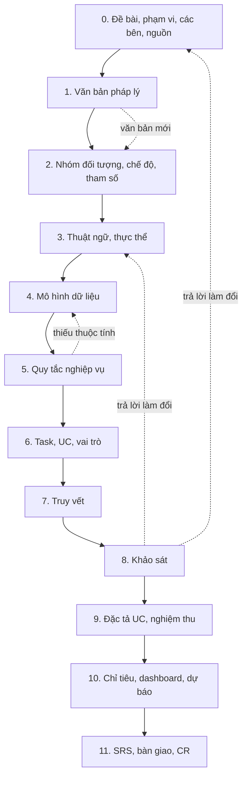

# Quy trình BA chuẩn: từ đề bài đến tài liệu đặc tả

Phiên bản 0.1, lập ngày 30/10/2026. Rút ra từ cách làm của project019 (module tích hợp và phân tích dữ liệu an sinh xã hội).

## 1. Mục đích và cách dùng

Tài liệu này quy định BA cần làm gì và làm như thế nào khi nhận một đề bài mới. Quy trình phù hợp với các dự án có ba đặc điểm:

* nghiệp vụ chịu điều chỉnh của văn bản pháp luật;
* dữ liệu lấy từ nhiều nguồn bên ngoài;
* sản phẩm gồm tính toán, thống kê, dashboard hoặc dự báo.

Với dự án thiếu một trong ba đặc điểm, bỏ bước tương ứng và ghi lý do vào kế hoạch BA.

Mỗi bước ở mục 5 viết theo cùng một khung:

| Mục | Trả lời câu hỏi |
|---|---|
| Mục tiêu | Bước này giải quyết việc gì |
| Đầu vào | Cần có gì trước khi làm |
| Cách làm | Làm theo trình tự nào |
| Câu hỏi gợi ý | Hỏi ai, hỏi gì |
| Đầu ra và bộ cột | Ghi vào bảng nào, gồm những cột nào |
| Cổng kiểm | Đạt điều kiện nào thì sang bước sau |
| Lỗi thường gặp | Chỗ dễ sai, rút từ project019 |

Ký hiệu trong bảng cột: cột không đánh dấu là cột file `output/project019_013_checklist_kem_so_do_uml.xlsx` đã có. Cột đánh dấu **(+)** là đề xuất bổ sung, file 013 chưa có.

## 2. Nguyên tắc chung

1. **Một nguồn sự thật.** Mọi bảng đầu ra nằm trong một sổ làm việc. Các bản báo cáo là bản chụp tại ngày lập, không sửa song song.
2. **Mọi điều chưa chốt mang nhãn.** Dùng hai nhãn "Giả định" và "Chờ đối chiếu". Tài liệu bàn giao không trình bày giả định như phạm vi đã chốt.
3. **Mọi dòng có căn cứ.** Quy tắc, tham số, chế độ phải trỏ tới văn bản, điều, khoản. Không có căn cứ thì ghi "đề xuất BA".
4. **Không viết số chưa đếm.** Số liệu trong tài liệu phải đếm từ dữ liệu hoặc đối chiếu chéo giữa các bảng trước khi ghi.
5. **Mã định danh không dùng lại.** Mã đã cấp rồi bỏ thì để trống, không cấp cho đối tượng khác.
6. **Dữ liệu cá nhân chỉ ghi thống kê và mẫu đã che.** Dữ liệu ví dụ ghi rõ "dữ liệu giả".
7. **Ô trống là câu hỏi.** Mỗi chỗ thiếu thông tin sinh một câu hỏi có mã, có người cần hỏi.
8. **Ghi sai sót ngay khi gặp.** Lỗi tự phát hiện cũng ghi vào nhật ký, không đợi được nhắc.

## 3. Tổng quan quy trình

### 3.1. Mạch chính

### 3.2. Bảng tổng hợp

| Bước | Giai đoạn | Việc | Đầu ra chính | Cổng kiểm |
|---|---|---|---|---|
| 0 | Khởi động | Đọc đề bài, chốt phạm vi, xác định các bên, kiểm kê nguồn | Mâu thuẫn và rủi ro; Các bên liên quan (+); Nguồn tích hợp (+) | Biết phục vụ ai, lấy dữ liệu từ đâu |
| 1 | Hiểu miền | Xác định văn bản pháp lý | Căn cứ pháp lý | Mỗi nhóm đối tượng có văn bản còn hiệu lực |
| 2 | Hiểu miền | Nhóm đối tượng, chế độ, tham số | Chế độ theo nhóm đối tượng; Tham số | Mỗi chế độ trỏ tới điều khoản và tham số theo kỳ |
| 3 | Mô hình hóa | Thống nhất thuật ngữ, xác định thực thể | Thuật ngữ (+); danh sách thực thể | Một khái niệm chỉ có một tên |
| 4 | Mô hình hóa | Mô hình dữ liệu, từ điển, danh mục, chất lượng | Mô hình dữ liệu; Nguồn thực thể; Từ điển dữ liệu (+); Danh mục (+); Chất lượng dữ liệu (+); sơ đồ UML | Mọi trường cần dùng có chỗ lưu và người ghi |
| 5 | Yêu cầu | Quy tắc nghiệp vụ | Quy tắc BR | Mỗi BR chạy được trên mô hình |
| 6 | Yêu cầu | Task, UC, vai trò và phân quyền | Task và Usecase; Vai trò và phân quyền (+) | Mỗi UC có tác nhân, thực thể, BR |
| 7 | Yêu cầu | Truy vết | UC, thực thể, UML; Ma trận truy vết | Ô trống đã thành câu hỏi |
| 8 | Khảo sát | Đặt câu hỏi, họp, ghi biên bản | Checklist họp; Việc cần làm; biên bản | Câu ưu tiên Cao có trả lời hoặc nhãn Giả định |
| 9 | Đặc tả | Đặc tả UC, tiêu chí nghiệm thu, phi chức năng | Đặc tả UC; Tiêu chí nghiệm thu; Phi chức năng (+) | Dev biết làm gì, tester biết kiểm gì |
| 10 | Đặc tả | Chỉ tiêu, dashboard, dự báo | Chỉ tiêu và báo cáo (+); Kịch bản dự báo | Mỗi con số có công thức và nguồn |
| 11 | Bàn giao | Ghép SRS, bàn giao, quản lý thay đổi | Bàn giao và duyệt (+); Sổ CR (+) | Bản đặc tả được duyệt |

Ba bảng dùng suốt dự án, không gắn với bước nào: Checklist họp, Mâu thuẫn và rủi ro, Kế hoạch BA.

### 3.3. Cách đọc văn bản pháp lý để sinh đầu ra

Bước 1 quyết định phần lớn các bước sau. Khi đọc một điều khoản, phân loại câu chữ như sau:

| Trong văn bản có | Sinh ra | Ghi vào bước |
|---|---|---|
| Danh từ chỉ người, hồ sơ, giấy tờ, khoản tiền | Thực thể, thuộc tính | 3, 4 |
| Câu điều kiện ("được hưởng khi", "trường hợp") | Quy tắc BR | 5 |
| Con số: mức, hệ số, tuổi, thời hạn | Tham số theo kỳ | 2 |
| Thủ tục: lập, thẩm định, duyệt, chi trả | UC nghiệp vụ, tác nhân | 6 |
| Biểu mẫu, báo cáo định kỳ | Chỉ tiêu, trường dữ liệu | 4, 10 |
| "Sửa đổi", "thay thế", "hiệu lực từ" | Lịch sử phiên bản của BR và tham số | 1, 2, 5 |

## 4. Phân vai

| Bên | Vai trò trong quy trình | Bước tham gia chính |
|---|---|---|
| BA | Làm toàn bộ đầu ra, giữ sổ làm việc, đặt câu hỏi | Mọi bước |
| Bên giao việc | Chốt phạm vi, duyệt kế hoạch và tài liệu | 0, 8, 11 |
| Khách hàng nghiệp vụ | Trả lời câu hỏi nghiệp vụ, xác nhận BR | 2, 5, 8, 9 |
| Chủ nguồn dữ liệu | Cấp tài liệu API, dữ liệu mẫu, giải thích trường | 0, 4, 8 |
| Kiến trúc sư, dev | Góp ý mô hình dữ liệu, ước lượng | 4, 6, 9 |
| Tester | Dùng tiêu chí nghiệm thu làm kịch bản kiểm thử | 9 |

## 5. Chi tiết từng bước

### Bước 0. Đọc đề bài, chốt phạm vi, xác định các bên và nguồn

**Mục tiêu.** Biết hệ thống phục vụ ai, giải bài toán gì, lấy dữ liệu từ đâu. Tách phạm vi tổng thể với phạm vi đợt bàn giao.

**Đầu vào.** Đề bài, hợp đồng và phụ lục, checklist của khách hàng, trao đổi với bên giao việc.

**Cách làm.**
1. Đọc hết các tài liệu. Với mỗi tài liệu ghi: ai viết, viết cho ai, ngày nào, nói gì.
2. Liệt kê chỗ có thể hiểu theo hai cách. Mỗi chỗ ghi thành một dòng ở bảng Mâu thuẫn và rủi ro, kèm một câu hỏi.
3. Xác định nhóm nghiệp vụ theo nhu cầu của khách hàng. Không thu hẹp theo mốc bàn giao đầu tiên.
4. Liệt kê các bên liên quan và các nguồn dữ liệu.
5. Chủ động đề xuất use case và dạng đầu ra cho từng nhóm nghiệp vụ, kể cả biểu đồ và dashboard.
6. Chia phạm vi thành tổng thể và từng đợt bàn giao.

**Câu hỏi gợi ý.**
* Hệ thống phục vụ nhóm đối tượng nào? Đối tượng nào nằm ngoài?
* Ai dùng kết quả, dùng để ra quyết định gì?
* Mỗi nguồn dữ liệu là nơi lấy về hay nơi đẩy đi?
* Đã có hệ thống hiện hữu chưa? Làm mới hay nâng cấp?
* Mốc bàn giao đầu tiên cần những gì để chạy được?

**Đầu ra và bộ cột.**

Bảng Mâu thuẫn và rủi ro:

| Cột | Ghi gì |
|---|---|
| # | Số thứ tự |
| Nội dung | Điểm lệch hoặc rủi ro |
| Phía 1, Phía 2 | Hai cách hiểu, kèm tài liệu nguồn của mỗi cách |
| Trạng thái | Mở / Đã chốt |
| Ghi chú | |
| Ảnh hưởng tới T/UC (+) | Những T/UC đổi khi chốt theo một phía |
| Câu hỏi Q (+) | Mã câu hỏi tương ứng |
| Quyết định QD, ngày chốt (+) | |

Bảng Các bên liên quan (+):

| Cột | Ghi gì |
|---|---|
| Mã bên | SH-xx |
| Tổ chức, vai trò | Tên đơn vị hoặc vị trí |
| Quan hệ với dự án | Giao việc / duyệt / cấp dữ liệu / dùng / phát triển |
| Đầu mối | Chức danh |
| Kỳ vọng | Cần gì từ hệ thống |
| Nắm giữ tài liệu, dữ liệu | Thứ cần xin |
| Quyền quyết định | Chốt được việc gì |
| Câu hỏi liên quan | Mã Q |

Bảng Nguồn tích hợp (+):

| Cột | Ghi gì |
|---|---|
| Mã nguồn | NG-xx |
| Hệ thống, chủ quản | |
| Phương thức | API / tệp / kết nối CSDL |
| Chiều dữ liệu | Lấy về hay đẩy đi |
| Tần suất, độ trễ | |
| Khối lượng ước tính | |
| Thực thể cấp dữ liệu | Mã E, điền sau bước 4 |
| Khóa ghép | Trường nối với nguồn khác |
| Điều kiện kết nối | Xác thực, thỏa thuận chia sẻ |
| Tình trạng tài liệu | Có đặc tả / có dữ liệu mẫu / chưa có |
| Đầu mối, câu hỏi | Mã SH, mã Q |

Thêm báo cáo phạm vi và nguồn lực (ví dụ 003) và phiếu phân tích đề bài (ví dụ 004).

**Cổng kiểm.**
* [ ] Biết nhóm đối tượng trong và ngoài phạm vi, hoặc đã ghi giả định.
* [ ] Mỗi nguồn có chiều dữ liệu và đầu mối.
* [ ] Mỗi điểm lệch có câu hỏi và người cần hỏi.
* [ ] Phạm vi tổng thể tách khỏi phạm vi đợt đầu.

**Lỗi thường gặp.** Thu hẹp phạm vi khảo sát theo bản demo đầu tiên (PF-099). Xếp dashboard sai nhóm nghiệp vụ, không chủ động đề xuất đầu ra (PF-100).

### Bước 1. Xác định văn bản pháp lý

**Mục tiêu.** Có danh mục văn bản còn hiệu lực điều chỉnh từng nhóm đối tượng, biết văn bản nào sửa văn bản nào.

**Đầu vào.** Phạm vi đối tượng ở bước 0, văn bản được nêu trong đề bài.

**Cách làm.**
1. Bắt đầu từ văn bản đề bài nêu tên.
2. Lần lên luật gốc, lần xuống nghị định, thông tư hướng dẫn.
3. Tra văn bản sửa đổi, thay thế, văn bản hợp nhất. Đọc phần điều khoản chuyển tiếp.
4. Tra văn bản đã ban hành nhưng chưa có hiệu lực.
5. Thêm văn bản chung về dữ liệu, chia sẻ dữ liệu, bảo vệ dữ liệu cá nhân.
6. Với mỗi văn bản, ghi phạm vi đối tượng và điều khoản dùng cho phân tích.
7. Đối chiếu số điều với văn bản gốc, không chép từ nguồn thứ cấp.

**Câu hỏi gợi ý.**
* Văn bản này còn hiệu lực toàn bộ hay đã bị sửa một phần?
* Có văn bản nào sắp có hiệu lực làm đổi cách tính?
* Hồ sơ cũ áp dụng quy định nào trong giai đoạn chuyển tiếp?
* Địa phương có được quy định mức cao hơn không?

**Đầu ra và bộ cột.** Bảng Căn cứ pháp lý:

| Cột | Ghi gì |
|---|---|
| # | Số thứ tự cố định |
| Văn bản, Số hiệu | |
| Hiệu lực | Ngày có hiệu lực |
| Áp dụng từ | Ngày bắt đầu áp dụng trong tính toán |
| Nội dung dùng cho phân tích | Điều, khoản và tiêu chí rút ra |
| Usecase áp dụng | Mã T/UC |
| Cơ quan chủ quản | |
| Phạm vi đối tượng | Lõi / Mở rộng / Chung / Ngoài phân tích |
| Kiểm tra, ghi chú | Đã đối chiếu văn bản gốc chưa |
| Tình trạng (+) | Còn hiệu lực / hết / sửa một phần / chưa có hiệu lực |
| Sửa đổi bởi, thay thế bởi (+) | Số hiệu văn bản |
| Sinh ra (+) | Mã BR, tham số, thực thể |

**Cổng kiểm.**
* [ ] Mỗi nhóm đối tượng trong phạm vi có ít nhất một văn bản còn hiệu lực.
* [ ] Mỗi văn bản có tình trạng hiệu lực đã kiểm.
* [ ] Văn bản sắp có hiệu lực đã được liệt kê.

**Lỗi thường gặp.** Bỏ sót văn bản sửa đổi (ví dụ NĐ 63/2024 được sửa bởi NĐ 301/2026). Ghi sai số điều của điều khoản chuyển tiếp. Bỏ sót văn bản chưa có hiệu lực (ví dụ PL 05/2026 có hiệu lực từ 01/01/2027).

### Bước 2. Xác định nhóm đối tượng, chế độ và tham số

**Mục tiêu.** Với mỗi nhóm đối tượng, biết được hưởng chế độ gì, điều kiện nào, mức tính ra sao, áp dụng từ kỳ nào.

**Đầu vào.** Bảng Căn cứ pháp lý.

**Cách làm.**
1. Liệt kê nhóm đối tượng theo đúng cách văn bản phân loại.
2. Với mỗi nhóm, liệt kê chế độ: hằng tháng, một lần, hỗ trợ khác.
3. Viết công thức mức, tách con số thành tham số có mã.
4. Ghi các mức qua từng kỳ, mỗi kỳ một dòng.
5. Xác định quy tắc khi một người thuộc nhiều diện: hưởng mức cao nhất hay cộng dồn.
6. Ghi sự kiện làm đổi nhóm hoặc đổi mức (đủ tuổi, mất, thay đổi tình trạng).
7. Ghi trường dữ liệu cần để xác định nhóm và tính mức.

**Câu hỏi gợi ý.**
* Người thuộc hai diện thì hưởng thế nào?
* Mức chuẩn đổi vào ngày nào, có hồi tố không?
* Sự kiện nào làm người đó ra khỏi nhóm?

**Đầu ra và bộ cột.**

Bảng Chế độ theo nhóm đối tượng:

| Cột | Ghi gì |
|---|---|
| Mã nhóm | NH-xx |
| Nhóm đối tượng | |
| Điều kiện xác định | Tuổi, diện, tình trạng |
| Phạm vi | Lõi / Mở rộng, kèm câu hỏi đang chờ |
| Chế độ, Loại chi | Hằng tháng / một lần |
| Công thức mức | Ví dụ hệ số × mức chuẩn |
| Mã tham số, Mức hiện hành | |
| Văn bản, điều khoản (# căn cứ) | Trỏ về bước 1 |
| Áp dụng từ, Áp dụng đến | |
| Quy tắc giao nhau, BR | Mức cao nhất hay cộng dồn |
| Trường dữ liệu cần | Mã E và trường |
| Sự kiện làm đổi nhóm, đổi mức | |
| Mức xác minh, Trạng thái | |

Bảng Tham số:

| Cột | Ghi gì |
|---|---|
| Mã tham số | P-TEN-THAM-SO |
| Tên, Giá trị, Đơn vị | |
| Áp dụng từ, Áp dụng đến | Mỗi kỳ một dòng |
| Căn cứ | |
| Tin cậy | Đã xác minh văn bản gốc hay chưa |

**Cổng kiểm.**
* [ ] Mỗi chế độ trỏ tới điều, khoản.
* [ ] Mỗi con số trong công thức có mã tham số và khoảng hiệu lực.
* [ ] Quy tắc nhiều diện đã có cho từng nhóm.
* [ ] Cột "Trường dữ liệu cần" đã điền.

**Lỗi thường gặp.** Áp quy tắc "mức cao nhất" cho nhóm mà văn bản quy định cộng dồn. Ghi đè mức cũ khi có mức mới, làm mất khả năng tính lại kỳ trước.

### Bước 3. Thống nhất thuật ngữ và xác định thực thể

**Mục tiêu.** Có danh sách thực thể, mỗi thực thể có một tên và một định nghĩa.

**Đầu vào.** Danh từ trong văn bản (bước 1, 2), danh sách trường của các nguồn (bước 0), cột "Trường dữ liệu cần".

**Cách làm.**
1. Gom danh từ từ văn bản: người, hồ sơ, quyết định, chế độ, khoản chi.
2. Gom danh từ từ các nguồn dữ liệu.
3. Gộp danh từ trùng nghĩa. Tách danh từ cùng tên nhưng khác nghĩa.
4. Ghi định nghĩa một câu, nêu rõ ranh giới với khái niệm gần nghĩa.
5. Cấp mã thực thể. Tra mã cao nhất đã dùng trong mọi tài liệu trước khi cấp.
6. Xác định khóa nhận diện của từng thực thể.

**Câu hỏi gợi ý.**
* Nguồn A và nguồn B gọi khái niệm này bằng tên gì?
* "Đang hưởng" và "đáng hưởng" có phải hai thứ khác nhau?
* Lấy trường nào để nhận ra cùng một người giữa các nguồn?

**Đầu ra và bộ cột.** Bảng Thuật ngữ (+):

| Cột | Ghi gì |
|---|---|
| Thuật ngữ | Tên chuẩn |
| Định nghĩa | Một câu |
| Không nhầm với | Khái niệm gần nghĩa |
| Từ đồng nghĩa, không dùng | Cách gọi ở nguồn khác |
| Căn cứ | |
| Thực thể, trường tương ứng | Mã E |

**Cổng kiểm.**
* [ ] Một khái niệm chỉ có một tên trong mọi tài liệu.
* [ ] Mỗi thực thể có định nghĩa và khóa nhận diện.
* [ ] Mã mới không trùng mã đã dùng.

**Lỗi thường gặp.** Cấp mã thực thể trùng mã đã dùng ở tài liệu khác (PF-102).

### Bước 4. Dựng mô hình dữ liệu

**Mục tiêu.** Biết thực thể liên kết với nhau thế nào, lưu những trường gì, ai ghi, chạy lại thế nào khi nguồn đổi.

**Đầu vào.** Danh sách thực thể, Chế độ theo nhóm đối tượng, Nguồn tích hợp, dữ liệu mẫu nếu có.

**Cách làm.**
1. Vẽ quan hệ và lực lượng (một-nhiều, nhiều-nhiều) giữa các thực thể.
2. Ghi thuộc tính chính, trong đó có thời điểm hiệu lực.
3. Xếp mỗi thực thể vào một lớp: dữ liệu từ ETL/API, dữ liệu cấu hình, dữ liệu tổng hợp.
4. Ghi ai thêm hoặc sửa thực thể: ETL/API hay người dùng, vai trò nào, có bước duyệt không.
5. Ghi quy tắc chạy lại và phạm vi tính lại khi dữ liệu nguồn thay đổi.
6. Lập từ điển dữ liệu mức trường và bảng ánh xạ nguồn về mô hình.
7. Lập danh mục dùng chung và ánh xạ mã từng nguồn.
8. Khi có dữ liệu mẫu, chạy profiling và ghi kết quả vào bảng chất lượng.
9. Dựng sơ đồ UML. Xem lại ảnh sau khi dựng: chiều mũi tên, chữ còn hiện.

**Câu hỏi gợi ý.**
* Thực thể này do hệ thống nào ghi? Người dùng có được sửa tay không?
* Nguồn sửa dữ liệu quá khứ thì phải tính lại những gì?
* Có cần giữ lịch sử theo kỳ không?
* Mã địa bàn đổi sau sáp nhập thì ánh xạ thế nào?

**Đầu ra và bộ cột.**

Bảng Mô hình dữ liệu:

| Cột | Ghi gì |
|---|---|
| Thực thể | Mã E và tên |
| Ý nghĩa | Định nghĩa |
| Thuộc tính chính | Khóa và trường quan trọng |
| Quan hệ | Lực lượng với thực thể khác |
| Ví dụ | Bản ghi mẫu, dữ liệu giả |
| Nhóm | Có sẵn / đề xuất / phụ thuộc câu hỏi |
| UC, task sử dụng | |
| Lớp dữ liệu | ETL/API / cấu hình / tổng hợp |
| Ai thêm hoặc sửa | ETL/API hay vai trò, có duyệt không |
| Khóa nhận diện (+) | |
| Lưu lịch sử (+) | Có hay không, theo kỳ nào |
| Mức nhạy cảm (+) | Dữ liệu cá nhân cơ bản / nhạy cảm / không |
| Nguồn API (+) | Mã NG |

Bảng Nguồn thực thể:

| Cột | Ghi gì |
|---|---|
| Mã, Thực thể | |
| Lớp đề xuất | |
| So với nhận định đã nhận | Khớp / khác, nêu chỗ khác |
| Tác nhân ghi dữ liệu | |
| Chạy lại được không | |
| Khi thay đổi, ảnh hưởng tới | Chuỗi thực thể chịu ảnh hưởng |
| Phạm vi tính lại | Theo người / theo kỳ / toàn bộ |
| Lý do, điểm cần chốt | |

Bảng Từ điển dữ liệu (+):

| Cột | Ghi gì |
|---|---|
| Thực thể | Mã E |
| Mã trường, tên hiển thị | |
| Kiểu, độ dài | |
| Bắt buộc | |
| Khóa | PK / FK tới thực thể nào |
| Giá trị hợp lệ, danh mục | Mã DM hoặc miền giá trị |
| Nguồn (mã nguồn, trường gốc) | |
| Quy tắc chuyển đổi | |
| Xử lý khi thiếu hoặc lỗi | Gắn cờ / loại / lấy nguồn khác |
| Dữ liệu cá nhân | Có / không |
| BR dùng trường | |

Bảng Danh mục (+):

| Cột | Ghi gì |
|---|---|
| Mã danh mục, tên | DM-xx |
| Mã giá trị, tên giá trị | |
| Danh mục chuẩn | Theo văn bản hay quy chuẩn nào |
| Ánh xạ từ từng nguồn | |
| Hiệu lực từ, đến | |
| Giá trị thay thế | Mã cũ được thay bằng mã mới nào |

Bảng Chất lượng dữ liệu (+):

| Cột | Ghi gì |
|---|---|
| Mã DQ | DQ-xx |
| Thực thể, trường | |
| Chiều | Đúng / Đủ / Sạch / Sống |
| Quy tắc kiểm | Cách đo |
| Mẫu số | Đếm trên tập nào |
| Ngưỡng đạt | Ghi "giả định" khi chưa được xác nhận |
| Kết quả đo, ngày đo | Lấy từ profiling |
| Xử lý khi không đạt | |
| BR, UC bị ảnh hưởng | |

**Cổng kiểm.**
* [ ] Mọi trường ở cột "Trường dữ liệu cần" (bước 2) có trong từ điển.
* [ ] Mỗi thực thể có lớp dữ liệu và người ghi.
* [ ] Mỗi tham số có chỗ lưu và có phiên bản.
* [ ] Sơ đồ đã được xem lại sau khi dựng.
* [ ] Số liệu trong mô tả đã đếm theo mã, khớp giữa các bảng.

**Lỗi thường gặp.** Chỉ vẽ liên kết giữa thực thể mà bỏ sót ai thêm hoặc sửa từng thực thể (PF-103). Viết "13 trên 22 thực thể" khi chưa đếm (PF-106). Mũi tên vẽ ngược chiều tham chiếu (PF-109). Đưa ảnh sơ đồ vào tài liệu khi chưa xem, ảnh mất chữ (PF-110).

### Bước 5. Viết quy tắc nghiệp vụ

**Mục tiêu.** Mỗi điều kiện trong văn bản thành một quy tắc chạy được trên mô hình dữ liệu.

**Đầu vào.** Chế độ theo nhóm đối tượng, Tham số, Mô hình dữ liệu.

**Cách làm.**
1. Mỗi điều kiện hoặc công thức viết thành một BR dạng "NẾU [điều kiện trên thuộc tính thực thể] THÌ [kết quả]".
2. Dùng tên thuộc tính và mã tham số, không dùng con số cứng.
3. Ghi thứ tự ưu tiên và ngoại lệ giữa các BR.
4. Viết ít nhất một kịch bản kiểm cho mỗi BR với dữ liệu giả.
5. Thử chạy BR trên mô hình bằng tay. Thiếu thuộc tính thì quay lại bước 4.

**Câu hỏi gợi ý.**
* Hai BR mâu thuẫn thì BR nào thắng?
* BR này áp dụng cho kỳ nào?

**Đầu ra và bộ cột.** Bảng Quy tắc BR:

| Cột | Ghi gì |
|---|---|
| Mã BR, Nhóm, Tên | |
| Vai trò | Điều kiện / tính mức / kiểm tra |
| Logic (NẾU, THÌ) | |
| Tham số | Mã P |
| Ưu tiên, ngoại lệ | |
| Căn cứ | Văn bản, điều, khoản |
| Trạng thái | Đã đối chiếu / Giả định / Chờ đối chiếu |
| UC dùng | |
| Thực thể đọc, ghi (+) | Mã E và trường |
| Áp dụng từ, đến (+) | |

**Cổng kiểm.**
* [ ] Mỗi BR có căn cứ và trạng thái.
* [ ] Mỗi BR có ít nhất một kịch bản kiểm.
* [ ] Không còn con số cứng trong cột Logic.

**Lỗi thường gặp.** Viết BR bằng lời văn chung chung, không nêu thuộc tính nào, nên dev không cài được.

### Bước 6. Xác định Task, UC, vai trò và phân quyền

**Mục tiêu.** Có danh sách việc hệ thống phải làm, mỗi việc có tác nhân, dữ liệu và quy tắc.

**Đầu vào.** Thủ tục trong văn bản, nhu cầu khai thác ở bước 0, mô hình dữ liệu, BR.

**Cách làm.**
1. Lấy UC từ ba nguồn: thủ tục trong văn bản, nhu cầu khai thác (thống kê, dashboard, dự báo), nhu cầu vận hành dữ liệu (tích hợp, đối soát, chạy lại).
2. Đặt tên theo dạng tác nhân + động từ + đối tượng.
3. Tách task nền tảng (không có người dùng cuối) với UC nghiệp vụ.
4. Lập bảng vai trò, quyền trên từng thực thể, phạm vi dữ liệu theo địa bàn.
5. Ước lượng độ phức tạp, ngày công, giai đoạn.
6. Đối chiếu với danh mục yêu cầu của khách hàng (ví dụ phụ lục hợp đồng).

**Câu hỏi gợi ý.**
* Cán bộ cấp xã thấy dữ liệu của địa bàn nào?
* Ai được xem số định danh đầy đủ?
* Chức năng này làm mới hay nâng cấp hệ thống có sẵn?

**Đầu ra và bộ cột.**

Bảng Task và Usecase:

| Cột | Ghi gì |
|---|---|
| Mã, Nhóm, Task / Usecase, Mô tả | |
| Trục phân tích | Thời gian, địa bàn, nhóm đối tượng |
| Người dùng, giá trị | |
| Dữ liệu, phụ thuộc | |
| Độ phức tạp, Giai đoạn đề xuất, Ước lượng | |
| Căn cứ, giả định cần xác nhận | |
| Trạng thái xác nhận | |
| UC tham khảo của khách hàng | Mục tương ứng trong danh mục yêu cầu |

Bảng Vai trò và phân quyền (+):

| Cột | Ghi gì |
|---|---|
| Mã vai trò, tên | VTxx |
| Cấp, đơn vị | Trung ương / tỉnh / xã |
| Phạm vi dữ liệu | |
| UC được dùng | |
| Quyền trên thực thể | Xem / thêm / sửa / duyệt / xuất, theo từng mã E |
| Dữ liệu cá nhân được xem | Đầy đủ / đã che / chỉ số tổng hợp |
| Căn cứ | Tài liệu phân quyền, hoặc "đề xuất BA" |

**Cổng kiểm.**
* [ ] Mỗi UC có tác nhân, thực thể đọc hoặc ghi, BR.
* [ ] Mỗi vai trò ở cột "Ai thêm hoặc sửa" (bước 4) có trong bảng vai trò.
* [ ] Mỗi yêu cầu của khách hàng có UC tương ứng hoặc ghi lý do không làm.

### Bước 7. Lập ma trận truy vết

**Mục tiêu.** Lần được từ văn bản tới tiêu chí nghiệm thu theo một chuỗi không đứt.

**Đầu vào.** Kết quả bước 1 đến 6.

**Cách làm.**
1. Mỗi dòng nối: văn bản, điều → yêu cầu → BR → tham số → thực thể → T/UC → kịch bản kiểm.
2. Lập bảng UC × thực thể (ghi hoặc đọc) và UC × sơ đồ.
3. Đánh dấu ô trống. Mỗi ô trống sinh một câu hỏi ở bước 8.
4. Lập bảng ngược: từ sơ đồ hoặc thực thể tìm T/UC dùng nó.

**Đầu ra và bộ cột.**

Bảng UC, thực thể, UML:

| Cột | Ghi gì |
|---|---|
| Mã, Task / Usecase, Giai đoạn | |
| Thực thể ghi (G), Thực thể đọc (Đ) | |
| Sơ đồ lớp, Sơ đồ trạng thái, Sơ đồ nguồn ghi | |
| Ghi chú | |

Bảng Ma trận truy vết:

| Cột | Ghi gì |
|---|---|
| Văn bản, điều | |
| Nguồn yêu cầu (YC) | |
| BR | |
| T/UC | |
| Kịch bản | Mã TC |
| Giai đoạn đề xuất, Trạng thái UC | |
| Thực thể (+), Tham số (+) | |

**Cổng kiểm.**
* [ ] Mọi BR có ít nhất một UC dùng.
* [ ] Mọi UC có ít nhất một kịch bản kiểm.
* [ ] Mọi ô trống đã có câu hỏi.

### Bước 8. Đặt câu hỏi và khảo sát

**Mục tiêu.** Lấp các ô trống bằng câu trả lời có xác nhận. Ô chưa lấp được thì mang nhãn Giả định.

**Đầu vào.** Câu hỏi phát sinh ở mọi bước, bảng Các bên liên quan.

**Cách làm.**
1. Gom câu hỏi, gắn mức ưu tiên. Ưu tiên Cao là câu chặn nhiều UC hoặc chặn mốc gần nhất.
2. Gắn mỗi câu với T/UC, BR hoặc thực thể bị ảnh hưởng, và với bên cần hỏi.
3. Soạn agenda theo nhóm câu hỏi. Mỗi buổi họp chỉ mang câu ưu tiên Cao.
4. Tập dượt trước buổi họp: đoán câu trả lời, chuẩn bị câu hỏi tiếp theo.
5. Ghi biên bản với quyết định QD và việc cần làm VL.
6. Cập nhật trạng thái câu hỏi, sửa lại các bảng bị ảnh hưởng.
7. Câu chưa có trả lời: giữ nhãn Giả định, ghi giả định đang dùng.

**Đầu ra và bộ cột.**

Bảng Checklist họp:

| Cột | Ghi gì |
|---|---|
| STT, Nhóm | Mã Q |
| Câu hỏi, nội dung cần làm rõ | |
| Ưu tiên | Cao / Trung bình / Thấp |
| Trạng thái | Chưa hỏi / Đã hỏi / Đã rõ |
| Trả lời, ghi chú | Có ngày trả lời |
| Người phụ trách | |
| Gắn với (+) | Mã T/UC, BR, E |
| Hỏi ai (+) | Mã SH |
| Giả định đang dùng (+) | Dùng khi chưa có trả lời |
| Hạn (+) | |

Bảng Việc cần làm:

| Cột | Ghi gì |
|---|---|
| Mã | VL-xx, đánh số liên tục toàn dự án |
| Việc, Trạng thái | |
| Tài liệu nguồn | Biên bản hoặc báo cáo sinh ra việc |
| Đầu vào, ghi chú | |

**Cổng kiểm.**
* [ ] Câu ưu tiên Cao đã có trả lời hoặc nhãn Giả định.
* [ ] Mỗi câu trả lời đã được áp vào các bảng liên quan.

**Lỗi thường gặp.** Ghi câu trả lời vào biên bản nhưng không sửa lại mô hình và BR, làm hai nơi mâu thuẫn.

### Bước 9. Đặc tả UC, tiêu chí nghiệm thu và yêu cầu phi chức năng

**Mục tiêu.** Dev biết phải làm gì, tester biết phải kiểm gì.

**Đầu vào.** Mọi bảng ở bước 1 đến 8.

**Cách làm.**
1. Xếp UC theo mức sẵn sàng: M1 đủ để đặc tả đầy đủ, M2 thiếu một phần, M3 còn giả định lớn.
2. Đặc tả đầy đủ UC mức M1 trước. UC mức M2, M3 viết thẻ đặc tả và danh sách câu hỏi chặn.
3. Viết tiêu chí nghiệm thu theo dạng Cho, Khi, Thì với dữ liệu giả và con số kiểm được.
4. Viết yêu cầu phi chức năng đo được.
5. Tập dượt đặc tả: đặt mình vào vai dev và tester để tìm chỗ thiếu.

**Đầu ra và bộ cột.**

Bảng Đặc tả UC, chia năm nhóm cột:

| Nhóm | Cột |
|---|---|
| Định danh | Mã; Task / Usecase; Giai đoạn; Mức đặc tả; Mức sẵn sàng |
| Nội dung | Mục tiêu, phạm vi; Tác nhân và phân quyền; Điều kiện, phụ thuộc; Luồng chính; Luồng thay thế; Luồng ngoại lệ |
| Liên kết | Quy tắc nghiệp vụ (BR); Dữ liệu; Màn hình và đầu ra; Phi chức năng; Tiêu chí nghiệm thu |
| Còn mở | Giả định và câu hỏi mở; Bị chặn bởi; Trạng thái xác nhận |
| Việc tiếp | Việc BA cần làm; Việc phát triển, kiểm thử; Nguồn |

Bảng Tiêu chí nghiệm thu:

| Cột | Ghi gì |
|---|---|
| Mã | TC-UCxx-nn hoặc TC-BRxx-nn |
| Loại | UC / BR |
| Thuộc UC / BR | |
| Cho (dữ liệu giả) | Trạng thái dữ liệu ban đầu |
| Khi | Hành động |
| Thì | Kết quả có con số |
| BR, luồng kiểm | |
| Kết quả kiểm, Ghi chú | |

Bảng Phi chức năng (+):

| Cột | Ghi gì |
|---|---|
| Mã NFR, Loại | Hiệu năng / bảo mật / lưu vết / sẵn sàng / lưu trữ / bảo vệ dữ liệu cá nhân |
| Yêu cầu | Viết đo được |
| Căn cứ | Văn bản, hợp đồng |
| Cách kiểm | |
| UC áp dụng | |

**Cổng kiểm.** Một UC đủ để bàn giao khi trả lời được bảy ý:
* [ ] Tác nhân, vai trò, quyền.
* [ ] Điều kiện kích hoạt, tiền điều kiện, hậu điều kiện.
* [ ] Dữ liệu vào và ra, thực thể nguồn và người ghi.
* [ ] Các BR áp dụng, mỗi BR có căn cứ còn hiệu lực.
* [ ] Luồng chính, luồng thay thế, luồng ngoại lệ.
* [ ] Tiêu chí nghiệm thu có con số kiểm được.
* [ ] Mọi điểm chưa chốt có câu hỏi và nhãn Giả định.

### Bước 10. Chỉ tiêu, dashboard và dự báo

**Mục tiêu.** Mỗi con số hiển thị hoặc dự báo có định nghĩa, công thức, nguồn dữ liệu và căn cứ.

**Đầu vào.** Biểu mẫu báo cáo trong văn bản, nhu cầu khai thác, mô hình dữ liệu, chế độ và tham số.

**Cách làm.**
1. Liệt kê chỉ tiêu từ biểu mẫu báo cáo pháp định và từ nhu cầu khai thác.
2. Viết công thức: tử số, mẫu số, điều kiện lọc, thời điểm chốt số.
3. Chọn chiều phân tích và dạng hiển thị cho từng chỉ tiêu.
4. Với dự báo, ghép ba phần: số đối tượng theo nhóm và địa bàn, chế độ và mức, kịch bản thay đổi tham số.
5. Phân biệt thay đổi xác định theo luật (đủ tuổi, đổi mức chuẩn) với thay đổi cần ước lượng thống kê.

**Đầu ra và bộ cột.**

Bảng Chỉ tiêu và báo cáo (+):

| Cột | Ghi gì |
|---|---|
| Mã chỉ tiêu | CT-xx |
| Tên, định nghĩa | |
| Công thức | Tử số, mẫu số, điều kiện lọc |
| Đơn vị, kỳ | |
| Chiều phân tích | |
| Thực thể, BR dùng | |
| Ngưỡng cảnh báo | |
| Dạng hiển thị | |
| Người xem, UC | |
| Mẫu báo cáo theo văn bản | |

Bảng Kịch bản dự báo:

| Cột | Ghi gì |
|---|---|
| Mã, Kịch bản, Loại thay đổi, Kỳ | |
| Biến đầu vào, Tham số pháp lý | |
| Công thức | |
| Dữ liệu cần (thực thể) | |
| Phương pháp | Xác định theo luật / ước lượng |
| Đầu ra | |
| BR, UC | |
| Câu hỏi mở, việc | |
| Mức sẵn sàng | |

**Cổng kiểm.**
* [ ] Mỗi chỉ tiêu có công thức và thực thể nguồn.
* [ ] Dự báo nêu rõ phần nào xác định, phần nào ước lượng.
* [ ] Không dùng số giả làm kết quả thật.

### Bước 11. Ghép SRS, bàn giao và quản lý thay đổi

**Mục tiêu.** Bàn giao tài liệu đã được duyệt. Sau khi duyệt, mọi thay đổi đi qua quy trình CR.

**Cách làm.**
1. Ghép các bảng thành SRS theo khung chuẩn: phạm vi, thuật ngữ, mô hình dữ liệu, BR, UC, phi chức năng, truy vết.
2. Liệt kê mọi mục còn giả định ở phần đầu tài liệu.
3. Soát văn phong tài liệu bàn giao.
4. Gửi, ghi nhận ý kiến, sửa, gửi lại đến khi được duyệt.
5. Sau khi duyệt, mọi thay đổi lập CR, đánh giá ảnh hưởng, chờ duyệt rồi mới sửa.

**Đầu ra và bộ cột.**

Bảng Bàn giao và duyệt (+):

| Cột | Ghi gì |
|---|---|
| Tài liệu, phiên bản | |
| Ngày gửi, người nhận | |
| Phạm vi | UC, BR có trong bản |
| Mục còn giả định | Kèm mã Q |
| Ý kiến phản hồi | |
| Trạng thái | Đã gửi / có ý kiến / đã duyệt |

Bảng Sổ CR (+):

| Cột | Ghi gì |
|---|---|
| Mã CR, ngày | |
| Người yêu cầu | Mã SH |
| Nội dung thay đổi | |
| Lý do, căn cứ | Văn bản mới, quyết định QD |
| Ảnh hưởng | BR, tham số, E, UC, TC bị sửa |
| Công sức thêm | |
| Quyết định | Chấp nhận / hoãn / từ chối; người duyệt |
| Phiên bản tài liệu sau thay đổi | |

**Cổng kiểm.**
* [ ] Tài liệu có danh sách mục còn giả định.
* [ ] Văn phong đã soát đạt.
* [ ] Có xác nhận duyệt của bên giao việc.

## 6. Ba bảng dùng suốt dự án

| Bảng | Khi nào ghi | Bộ cột chính |
|---|---|---|
| Checklist họp | Mỗi khi phát sinh điểm chưa rõ, ở bất kỳ bước nào | Xem bước 8 |
| Mâu thuẫn và rủi ro | Khi hai tài liệu nói khác nhau, hoặc thấy rủi ro | Xem bước 0 |
| Kế hoạch BA | Đầu dự án, cập nhật sau mỗi buổi họp | Mã; Việc; Thuộc; Người làm; Ngày công; Hạn; Phụ thuộc; Đầu ra; Trạng thái; Ngày xong; Ghi chú |

## 7. Mã định danh và cột khóa

### 7.1. Mã định danh

| Mã | Nghĩa |
|---|---|
| SH-xx (+) | Bên liên quan |
| NG-xx (+) | Nguồn tích hợp |
| Qxx | Câu hỏi |
| YC-xx | Yêu cầu từ bên giao việc hoặc văn bản |
| NH-xx | Nhóm đối tượng |
| P-TEN-THAM-SO | Tham số |
| Exx | Thực thể; mã đã cấp không dùng lại |
| DM-xx (+) | Danh mục |
| DQ-xx (+) | Quy tắc chất lượng dữ liệu |
| BR-xx | Quy tắc nghiệp vụ |
| VTxx | Vai trò |
| Txx, UCxx | Task, use case |
| TC-UCxx-nn, TC-BRxx-nn | Tiêu chí nghiệm thu |
| NFR-xx (+) | Yêu cầu phi chức năng |
| CT-xx (+) | Chỉ tiêu |
| QD-xx, VL-xx | Quyết định, việc cần làm; VL đánh số liên tục toàn dự án |
| CR-xx | Yêu cầu thay đổi |

### 7.2. Cột khóa nối các bảng

Bộ bảng đạt yêu cầu khi lần theo một mã bất kỳ đi được qua mọi bảng liên quan.

| Mã | Xuất hiện ở |
|---|---|
| # căn cứ | Chế độ (Văn bản, điều khoản); BR (Căn cứ); Tham số (Căn cứ); Ma trận truy vết |
| P-TEN-THAM-SO | Chế độ (Công thức mức); BR (Tham số); Kịch bản dự báo (Tham số pháp lý) |
| Exx | Mô hình dữ liệu; Từ điển; UC, thực thể, UML; Đặc tả UC (Dữ liệu); Chỉ tiêu |
| BR-xx | Task và Usecase; Đặc tả UC; Tiêu chí nghiệm thu; Ma trận truy vết |
| VTxx | Mô hình dữ liệu (Ai thêm hoặc sửa); Vai trò và phân quyền; Đặc tả UC (Tác nhân) |
| Qxx | Mâu thuẫn và rủi ro; Đặc tả UC (Giả định, Bị chặn bởi); Chế độ (Phạm vi) |
| SH-xx | Checklist họp (Hỏi ai); Sổ CR (Người yêu cầu) |
| NG-xx | Mô hình dữ liệu (Nguồn API); Từ điển (Nguồn) |

## 8. Vòng lặp và xử lý thay đổi

Quy trình không đi thẳng một lần. Các trường hợp quay lại thường gặp:

| Tình huống | Quay lại bước | Bảng cần sửa |
|---|---|---|
| Tìm thấy văn bản mới hoặc văn bản sửa đổi | 1 | Căn cứ, Chế độ, Tham số, BR, Ma trận truy vết |
| BR thiếu thuộc tính để chạy | 4 | Mô hình, Từ điển |
| UC không có thực thể nguồn | 3 hoặc 8 | Thực thể, Checklist họp |
| Câu trả lời khảo sát đổi phạm vi đối tượng | 0 | Mọi bảng có cột Phạm vi |
| Nguồn không có trường cần thiết | 4, 8 | Từ điển, Chất lượng, Đặc tả UC (giả định) |
| Thay đổi sau khi tài liệu đã duyệt | 11 | Sổ CR, rồi mới sửa bảng liên quan |

Sau mỗi vòng sửa, rà lại cột khóa ở mục 7.2 để chắc các bảng không mâu thuẫn nhau.

## 9. Phụ lục: bản đồ áp dụng vào project019

| Bước | Sản phẩm project019 |
|---|---|
| 0 | 002 bối cảnh bài toán; 003 báo cáo use case và nhân sự; 004 phân tích input |
| 1 | 006 rà soát căn cứ pháp lý; 017 lịch sử thay đổi chính sách |
| 2 | 010 căn cứ pháp lý và tham số theo kỳ; sheet Chế độ theo nhóm đối tượng, Tham số NCC, Tham số TGXH |
| 3, 4 | 007 rà soát mô hình dữ liệu và sơ đồ UML; sheet Mô hình dữ liệu, Nguồn thực thể |
| 5, 7 | 011 đặc tả quy tắc và truy vết; sheet Quy tắc BR, Ma trận truy vết |
| 6 | sheet Task và Usecase, UC tham khảo PL III |
| 8 | sheet Checklist họp, Việc cần làm (VL) |
| 9 | 015 đặc tả sơ bộ task và UC; sheet Đặc tả UC, Tiêu chí nghiệm thu |
| 10 | sheet Kịch bản dự báo, Mô phỏng dự báo |
| Kế hoạch | 014 việc cần làm và kế hoạch sơ bộ; sheet Kế hoạch BA |

Các bảng đánh dấu (+) chưa có trong file 013. Muốn dùng thì thêm qua script `cap_nhat_checklist.py`, không sửa Excel bằng tay.
